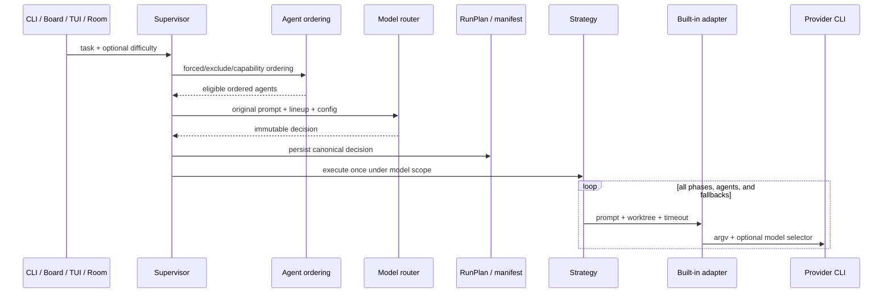

# Difficulty-based provider model routing — implementation plan

> **Canonical tracked plan.** 이 문서는 작업 복잡도에 따라 provider 내부 모델을
> 선택하는 기능의 단일 구현 계약이다. 구현 후에는 이 문서의 상태와 검증 결과를
> 갱신하며, 동일한 acceptance checklist를 다른 문서에 복제하지 않는다.

- **상태:** PR 1 IMPLEMENTED (observe + explicit; enforce/PR 2는 §8 gate 대기)
- **작성·검증일:** 2026-07-22 · **PR 1 구현일:** 2026-07-23
- **대상:** SyncMill maintainers
- **PR 1 구현:** branch `feat/model-routing-pr1` — `model_routing.py`(분류기 +
  canonical decision), `[model_routing]` config, `--difficulty`, `_MODEL_SELECTORS`
  scope + 세 builder의 model flag, `RunPlan.model_routing`(off면 키 생략),
  monitor 전달, `continue` selector affinity, EN/KO 문서. 검증: 전체 hermetic
  suite green + Ruff clean + `git diff --check` clean; classifier §10.1 boundary
  matrix, 세 provider fresh/resume 정확 argv, fake-provider E2E(선택자 전달·affinity·
  observe no-flag), off-mode golden plan 직렬화. CLI 재확인(2026-07-22): Claude
  Code 2.1.217, Codex CLI 0.145.0, Kimi Code 0.23.5.

Provider CLI와 모델 catalog는 빠르게 바뀐다. 이 문서의 외부 사실은 작성일에 공식
문서와 로컬 CLI 도움말로 확인했지만, 실제 구현과 release 전에 다시 확인해야 한다.
모델 ID, alias, 가격은 SyncMill의 고정 계약으로 취급하지 않는다.

---

## 1. Outcome

SyncMill이 top-level task의 prompt complexity를 한 번 판정하고, 사용자가 provider별로
설정한 `low`, `medium`, `high` 모델 selector 중 하나를 선택할 수 있게 한다.

이 기능은 다음을 **바꾸지 않는다**.

- agent/provider 후보와 우선순위
- capability matching 결과
- `route`, `pipeline`, `compete`, `council`, `decompose` 전략의 topology
- quality gate, circuit breaker, winner selection 의미
- provider CLI의 기본 모델과 alias 해석

즉, 기존 agent ordering이 확정된 뒤 선택된 agent가 어느 provider-internal 모델을
사용할지만 결정한다.

### 1.1 용어

| 용어 | 이 문서에서의 의미 |
| --- | --- |
| agent routing | `agent_priority`, forced agent, exclude, capability matching으로 실행 agent 순서를 정하는 기존 기능 |
| orchestration strategy | 여러 agent 호출을 구성하는 `route`, `pipeline`, `compete`, `council`, `decompose` |
| model routing | 한 agent가 호출할 provider 내부 모델 selector를 선택하는 이 계획의 기능 |
| tier | 비용·성능 역할을 나타내는 `low`, `medium`, `high`; 실제 모델명은 아님 |
| selector | provider CLI의 `--model`/`-m`에 전달할 사용자 설정 문자열 |
| effective selector | 실제 argv에 전달한 selector; `null`이면 model flag를 생략했다는 뜻 |
| selector affinity | continuation이 이전 selector 또는 no-flag 정책을 상속한다는 보장 |

`prompt-complexity-v1`은 실제 작업 난이도, 예상 token 수, 성공 가능성을 측정하는 모델이
아니다. 원본 prompt에서 보수적인 구조·위험 신호를 찾는 deterministic heuristic이다.
자동 라우팅의 품질과 비용 효과는 observe 데이터를 통해 별도로 입증해야 한다.

### 1.2 Goals

- 명시적 `low|medium|high` override를 provider model flag로 전달한다.
- 별도 네트워크·LLM 호출 없이 `auto` tier를 결정한다.
- top-level run당 결정을 정확히 한 번 만들고 모든 strategy phase가 공유한다.
- normal output은 작게 유지하면서 dry-run과 artifact에는 설명 가능한 근거를 남긴다.
- 기본 `off` 경로의 기존 argv와 실행 의미를 보존한다.
- provider-native continuation에서 이전 effective selector 정책을 보존한다.
- observe → 평가 → enforce 순서로 자동 적용 위험을 제한한다.

### 1.3 Non-goals

- agent/provider 자체를 난이도로 선택하거나 순서를 바꾸는 기능
- phase, subtask, retry마다 tier를 다시 계산하는 기능
- LangChain, LangGraph, Deep Agents 또는 별도 classifier LLM 도입
- provider model catalog 조회, alias 검증, 가격표 유지
- 모든 provider에서 실제 resolved canonical model을 수집하는 기능
- interactive provider session을 SyncMill 밖에서 제어하는 기능
- v1에서 비용 절감률을 실시간 표시하거나 보장하는 기능
- run envelope 또는 OTLP/Tracegraph public contract 확장

---

## 2. Current baseline and design constraints

### 2.1 Current seams

- `AgentConfig`에는 현재 `enabled`, `timeout_seconds`, `max_turns`만 있으며 model 설정은
  없다 (`src/syncmill/config.py:18-29`).
- real agent ID는 `claude`, `codex`, `kimi-code`이며 설정 field는 각각 `claude`,
  `codex`, `kimi_code`다 (`config.py:710-728,792-798`).
- Supervisor는 forced/exclude 처리 후 capability matcher를 한 번 적용하고 strategy를
  호출한다 (`supervisor.py:213-299,535-545`). Model routing은 이 ordering을 소비해야
  하며 변경해서는 안 된다.
- `RunPlan`은 strategy topology의 canonical bounded projection이며 manifest의 `plan`에
  이미 저장된다 (`planning.py:11-56`, `artifacts.py:562,609`).
- `agents.py`에는 output sink, tool capture, provider session을 위한 `ContextVar`와
  reset-safe context manager가 이미 존재한다 (`agents.py:85-127,259-273`).
- 세 provider command builder는 fresh/resume 명령을 만들지만 model flag를 넣지 않는다
  (`agents.py:602-619,752-759,874-886`).
- `syncmill continue`는 winning agent와 provider session을 복원하지만 model selector는
  저장하거나 복원하지 않는다 (`cli.py:464-526`).
- Rooms는 Supervisor가 아니라 `aexecute_isolated`를 직접 호출하므로 별도 integration
  boundary다 (`rooms.py:1923-1955`).

### 2.2 Invariants

1. **Ordering before model selection.** Forced agent, exclude, enabled state, team overlay,
   capability matching 결과가 먼저 확정된다.
2. **One decision per top-level run.** Strategy가 prompt를 변형하거나 여러 agent를
   호출해도 tier를 다시 계산하지 않는다.
3. **Built-in adapter scope only.** `AgentRunner(prompt, workdir, timeout)` protocol은
   변경하지 않는다. Model scope를 모르는 fake/custom runner는 기존처럼 동작한다.
4. **User-owned mappings.** SyncMill은 추천 model ID나 provider alias를 내장하지 않는다.
5. **No silent cost-control typo.** 알 수 없는 provider mapping key는 advisory warning이
   아니라 config error다.
6. **One canonical serialization.** Routing metadata를 `TaskResult`, result JSON, envelope,
   trace에 각각 복제하지 않는다.
7. **No body leakage.** Reason에는 prompt excerpt, 파일 내용, stdout/stderr를 넣지 않는다.
8. **Disabled means legacy behavior.** `mode=off`이고 CLI override도 없으면 routing scope,
   model flag, routing artifact block을 만들지 않는다.

---

## 3. Public contract

### 3.1 Configuration

PR 1은 다음 설정을 추가한다.

```toml
[model_routing]
mode = "observe"                  # off | observe
classifier = "prompt-complexity-v1"

[model_routing.models.low]
claude = "<user-defined-selector>"
codex = "<user-defined-selector>"
kimi-code = "<user-defined-selector>"

[model_routing.models.medium]
claude = "<user-defined-selector>"
codex = "<user-defined-selector>"
kimi-code = "<user-defined-selector>"

[model_routing.models.high]
claude = "<user-defined-selector>"
codex = "<user-defined-selector>"
kimi-code = "<user-defined-selector>"
```

PR 2는 평가 gate 통과 후 `mode = "enforce"`를 추가한다. 기본값은 두 PR 모두 `off`다.

```python
DifficultyTier = Literal["low", "medium", "high"]
ModelRoutingModeV1 = Literal["off", "observe"]
ModelRoutingModeV2 = Literal["off", "observe", "enforce"]
```

`ModelRoutingConfig`의 규칙은 다음과 같다.

- `extra="forbid"`로 routing table 내부 typo를 거부한다.
- `models`는 `low`, `medium`, `high` 외 tier key를 거부한다.
- provider key는 built-in real ID `claude`, `codex`, `kimi-code`만 허용한다.
- selector는 `^\S{1,256}$`을 만족하고 ASCII control character를 포함하지 않아야 한다.
- mapping table과 개별 provider entry는 생략 가능하다.
- model catalog나 alias 존재 여부는 config construction에서 확인하지 않는다.

기존 source precedence를 그대로 쓴다.

1. explicit constructor/CLI runtime override
2. `SYNCMILL_*` environment
3. project `syncmill.toml`
4. defaults

대표 환경변수 형태:

```bash
SYNCMILL_MODEL_ROUTING__MODE=observe
SYNCMILL_MODEL_ROUTING__CLASSIFIER=prompt-complexity-v1
SYNCMILL_MODEL_ROUTING__MODELS='{"low":{"codex":"<selector>"}}'
```

Provider mapping은 TOML을 canonical user-facing 형식으로 문서화하고, JSON environment
형식은 CI나 임시 override용으로만 안내한다.

### 3.2 CLI

PR 1에서 `syncmill run`에 다음 옵션을 추가한다.

```text
--difficulty [auto|low|medium|high]
```

| config/CLI 입력 | PR 1 동작 | PR 2 동작 |
| --- | --- | --- |
| `mode=off`, 옵션 없음 | 기존 동작 | 기존 동작 |
| `mode=observe`, 옵션 없음 | auto 추천만 기록 | auto 추천만 기록 |
| `--difficulty auto` | 해당 run을 observe | `mode=enforce`면 적용, 아니면 observe |
| `--difficulty low|medium|high` | 명시 tier를 즉시 적용 | 동일 |
| `syncmill continue` | 이전 effective selector 상속 | 동일 |

명시적 tier는 사용자가 model routing을 직접 요청한 것이므로 config mode가 `off`여도
적용한다. `syncmill continue`에는 `--difficulty`를 추가하지 않는다. 기존 conversation을
다른 model 정책으로 바꾸려면 새 `syncmill run`을 시작한다.

### 3.3 Missing mappings

Routing decision은 최종 eligible lineup의 모든 agent ID에 대해 selector map을 만든다.
여기서 eligible lineup은 **post-matcher, pre-breaker** 시점의 순서 확정된 후보 집합이다
— breaker OPEN skip이나 phase 내 탈락으로 runnable set이 이후 줄어들어도 decision의
selector map은 다시 계산하지 않는다 (invariant 2).

- 한 agent의 tier mapping이 없으면 recommended/effective selector에 `null`을 기록하고
  model flag를 생략한다.
- observe에서는 모든 mapping이 비어 있어도 classifier calibration을 위해 실행한다.
- explicit/enforce 적용에서 eligible agent 전체의 mapping이 비어 있으면 실행 전에
  `Model routing selected <tier>, but no eligible agent has a mapping` 오류로 실패한다.
- 일부 agent만 비어 있으면 실행은 허용하되 dry-run과 compact banner에
  `<N> cli-default`를 표시한다.
- `route` fallback이 mapping 없는 agent에 도달하면 해당 provider CLI default를 쓴다.

이 규칙은 사용자 정의 mapping을 강제하지 않으면서도 “적용했다고 생각했지만 실제로는
어떤 model flag도 없었던” 완전한 no-op을 방지한다.

### 3.4 Output

Routing이 사용된 run만 normal output에 한 줄을 추가한다.

```text
[syncmill] model routing: medium / observe / not applied / 1 cli-default
[syncmill] model routing: low / explicit / applied
```

Normal output에는 marker 목록, score, 전체 provider→selector map을 표시하지 않는다.
`--dry-run`의 JSON plan과 durable manifest에는 canonical decision 전체를 기록한다.
Default `off` run의 출력은 바꾸지 않는다.

---

## 4. Deterministic classifier v1

### 4.1 Input and normalization

Classifier 입력은 사용자가 작성한 top-level task 원문 하나다.

- 직접 `syncmill run`: `Task.prompt` 원문.
- Board run (PR 2): **raw `item.task`** — `render_item_prompt`가 주입하는 goal
  header, decisions, handoff, inputs가 붙은 enriched prompt가 아니다. 주입된
  decision 텍스트(예: `배포`, `security` 언급)가 해당 goal의 모든 item을 `high`로
  끌어올리는 오염을 막기 위해, `run_item`은 enrichment **전의** 텍스트로 decision을
  만든 뒤 Task를 구성한다.

1. Unicode NFKC normalization
2. `casefold()`
3. CRLF/CR을 LF로 변환
4. 양 끝 whitespace 제거

저장소 파일, Git diff, task tags, memory, conversation history, provider output, network,
LLM은 읽지 않는다. 같은 normalized prompt는 process와 platform에 관계없이 같은 tier와
reason code를 반환해야 한다.

### 4.2 Structural counters

- `char_count`: normalized string의 Unicode code point 수
- `nonempty_lines`: whitespace-only line을 제외한 줄 수
- `list_items`: `^\s*(?:[-*+]|\d+[.)])\s+`에 맞는 line 수
- `path_targets`: path-like token `(?<!\w)(?:\.{0,2}/)?[\w.@+-]+(?:/[\w.@+-]+)+`의
  normalized distinct 집합 크기. **URL은 제외한다** — `://`를 포함한 token은 세지
  않는다 (문서 링크를 인용한 prompt가 multi-target으로 오인되는 것을 막는다).
- `targets`: `path_targets` 집합과 한 줄 안의 non-empty inline code span
  (`` `...` ``) 집합의 합집합 크기.

같은 target 반복은 한 번만 센다. Fenced code block 전체를 하나의 target으로 세지 않으며,
그 안의 path-like token은 일반 규칙대로 센다. High 규칙(§4.4의 3)은 `path_targets`만
사용한다 — inline code span은 `rename `foo` to `bar` in `baz.py`` 같은 좁은 기계적
작업에도 3개가 쉽게 모여, span까지 세면 가장 저렴해야 할 prompt가 가장 비싼 tier로
승격되는 역전이 생긴다. Span은 low 규칙의 좁은-범위 판정(`targets <= 1`)에만 쓴다.

### 4.3 Exact semantic marker families

English marker match는 substring이 아니라 Unicode letter/digit boundary를 적용한
phrase match다. 하이픈·underscore 차이는 공백과 동일하게 정규화한다.

**Korean marker는 boundary match를 쓰지 않는다.** 한국어는 교착어라 조사·어미가
marker에 붙어 한 letter run을 이룬다 (`마이그레이션을`, `배포해줘`, `보안이`) —
boundary 규칙으로는 실제 사용례 대부분이 match되지 않아 §8.1의 Korean recall gate를
통과할 수 없다. Korean marker는 **plain substring match**로 판정한다. 이로 인한
false positive(예: `인증서`가 `인증`에 match)는 v1의 보수적 방향(상위 tier로
over-routing)과 일치하므로 수용하고, §8.1 corpus에서 실측한다.

| Family | English markers | Korean markers |
| --- | --- | --- |
| high risk | `migration`, `schema change`, `authentication`, `authorization`, `security`, `permission`, `concurrency`, `race condition`, `data loss`, `backward compatibility`, `public api`, `deploy`, `deployment`, `release`, `production` | `마이그레이션`, `스키마 변경`, `인증`, `인가`, `보안`, `권한`, `동시성`, `경쟁 상태`, `데이터 손실`, `하위 호환`, `공개 api`, `배포`, `릴리스`, `운영` |
| broad scope | `entire repo`, `whole repository`, `across the repository`, `all modules`, `end to end`, `architecture`, `redesign` | `전체 저장소`, `저장소 전체`, `모든 모듈`, `전반`, `엔드투엔드`, `아키텍처`, `재설계` |
| simple intent | `status`, `show`, `list`, `summarize`, `translate`, `rename`, `typo`, `format`, `lint` | `상태`, `보여`, `목록`, `요약`, `번역`, `이름 변경`, `오타`, `포맷`, `린트` |

`fix`, `check`, `review`, `implement`, `explain`은 범위가 넓어 simple marker로 취급하지
않는다. Marker가 부정문 안에 있어도 v1은 의미 분석을 하지 않고 보수적으로 match한다.
같은 marker 반복은 tier를 추가 상승시키지 않는다.

### 4.4 Resolution rules

다음 순서에서 처음 일치하는 규칙을 사용한다.

1. `high_risk` marker가 하나 이상이면 `high`, reason `high_risk`.
2. `broad_scope` marker가 하나 이상이면 `high`, reason `broad_scope`.
3. `path_targets >= 3`이면 `high`, reason `multi_target`.
4. `char_count >= 1200`이고 `list_items >= 4`이면 `high`, reason
   `long_structured_prompt`.
5. 아래 조건을 모두 만족하면 `low`, reason `narrow_simple_intent`.
   - `char_count <= 240`
   - `nonempty_lines <= 3`
   - `targets <= 1`
   - `list_items <= 1`
   - simple marker가 하나 이상
6. 나머지는 `medium`, reason `default_medium`.

Score를 계산하거나 저장하지 않는다. 지원 marker가 없는 언어와 순수 코드 prompt는
structural high 규칙에 걸리지 않는 한 `medium`이다. 이는 low 오분류보다 medium
over-routing을 선호하는 보수적 정책이다.

### 4.5 Explicit and inherited decisions

- 명시적 `low|medium|high`는 classifier를 호출하지 않는다.
- inherited continuation은 classifier를 호출하지 않는다.
- explicit decision의 `classifier_version`은 `null`, reason은 `explicit_override`다.
- inherited decision의 `classifier_version`은 원래 값을 보존하고 reason에
  `selector_affinity`를 추가한다.

---

## 5. Decision model and lifecycle

### 5.1 Canonical type

```python
@dataclass(frozen=True)
class ModelRoutingDecision:
    schema_version: int
    requested: Literal["auto", "low", "medium", "high"]
    resolved_tier: Literal["low", "medium", "high"]
    source: Literal["auto", "explicit", "inherited"]
    classifier_version: str | None
    config_mode: Literal["off", "observe", "enforce"]
    applied: bool
    reason_codes: tuple[str, ...]
    recommended_selectors: Mapping[str, str | None]
    effective_selectors: Mapping[str, str | None]
```

Rules:

- `schema_version = 1`.
- mappings와 reason은 deterministic sorted order로 serialize한다.
- `recommended_selectors`는 resolved tier의 current config snapshot이다.
- observe의 `effective_selectors`는 모든 agent가 `null`이다.
- explicit/enforce의 `effective_selectors`는 recommended mapping과 같다.
- inherited decision은 parent manifest의 effective selector를 그대로 사용한다.
- decision은 생성 후 mutation하지 않는다.

Example observe block:

```json
{
  "schema_version": 1,
  "requested": "auto",
  "resolved_tier": "medium",
  "source": "auto",
  "classifier_version": "prompt-complexity-v1",
  "config_mode": "observe",
  "applied": false,
  "reason_codes": ["default_medium"],
  "recommended_selectors": {
    "claude": "<configured-selector>",
    "codex": null
  },
  "effective_selectors": {
    "claude": null,
    "codex": null
  }
}
```

### 5.2 Compute-once flow



The Router runs after `_matched_order` and before strategy dispatch. Council critique,
Decompose subtask, fallback prompt, gate rejection, retry, or provider failure never triggers a
new decision.

### 5.3 ContextVar execution scope

`agents.py`에 decision의 **immutable `effective_selectors` mapping**을 담는
`_MODEL_SELECTORS` `ContextVar`와 `model_routing_scope(selectors)` context
manager를 추가한다. (구현 노트: scope는 decision 객체 전체가 아니라 selector
mapping만 담는다 — `agents.py`가 `model_routing`을 import하지 않는 acyclic
경계를 지키기 위해서다. builder가 관찰하는 계약 — 자기 `agent_id` entry만
읽는다 — 은 동일하다.)

- default is `None` and preserves current command builders.
- token을 `finally`에서 reset한다.
- Supervisor wraps exactly one strategy execution; routing이 없으면 scope를
  아예 열지 않는다 (`nullcontext` — invariant 8).
- async task creation inherits the current scope, matching existing output/tool/session seams.
- built-in command builders select only their own `agent_id` entry.
- AgentRunner protocol and fake runners do not change.

Required safety tests include nested scopes, exception reset, sequential run leakage, concurrent
fan-out isolation, and a second top-level async run with a different selector.

### 5.4 RunPlan and artifacts

`RunPlan` receives one optional `model_routing` field. Default `off` uses `None`, and
`RunPlan.as_dict()` omits the key rather than serializing `null`, keeping disabled artifacts
compatible.

When present, `ModelRoutingDecision.as_dict()` is the only serializer. The same dict is used by
dry-run and the durable manifest's existing `plan` field.

PR 1 does **not** add routing metadata to:

- `TaskResult`
- `result.json`
- run envelope
- OTLP spans or Tracegraph allowlist
- Room events/candidate manifests

---

## 6. Provider adapter contract

Verified locally on 2026-07-22:

| Agent ID | Local CLI | Model flag | Fresh shape | Resume shape | No mapping |
| --- | --- | --- | --- | --- | --- |
| `claude` | Claude Code 2.1.217 | `--model SELECTOR` | `claude -p PROMPT ... --model SELECTOR` | existing `--resume SESSION` plus `--model SELECTOR` | omit flag |
| `codex` | Codex CLI 0.145.0 | `-m SELECTOR` | `codex exec -m SELECTOR PROMPT ...` | `codex exec resume -m SELECTOR -c sandbox_mode="workspace-write" -c approval_policy="on-failure" SESSION PROMPT ...` | omit flag |

Note (codex-cli 0.147.0): `codex exec resume` accepts neither `--full-auto` nor
`-s/--sandbox`, so the resumed argv reproduces the fresh run's `--full-auto`
semantics via the two `-c` config overrides shown above — a local-feasibility
observation like the §6 caveat below, pinned by exact-argv tests.
| `kimi-code` | Kimi Code 0.23.5 | `-m SELECTOR` | `kimi -m SELECTOR -p PROMPT ...` | existing `--session SESSION` plus `-m SELECTOR` | omit flag |

**Release revalidation (2026-08-01).** Local help was checked again with Claude
Code 2.1.220, Codex CLI 0.146.0, and Kimi Code 0.23.5. The documented fresh and
resume model flags remain available (`claude --model` with resume/session flags,
`codex exec -m` and `codex exec resume -m`, and `kimi -m` with `--session`).
This release check is separate from the historical 2026-07-22 implementation
snapshot above.

The selector is one argv element. No shell is used. Provider command order must be confirmed again
with each installed CLI's `--help` before implementation, and pinned by exact argv unit tests.

### 6.1 Invalid selectors

Local validation can reject malformed strings but cannot prove a selector exists or is available to
the user's account. A syntactically valid but unavailable selector therefore remains a provider
execution failure.

PR 1 deliberately does not parse provider-specific error prose into a new failure type. The raw
FAILED status follows existing route fallback and may be recorded by the optional circuit breaker.
After fixing the mapping, recovery waits for the configured `cooldown_seconds`; the next half-open
attempt runs and a success closes/resets the breaker. Temporarily disabling the breaker is the
immediate-retry workaround; there is no `syncmill breaker reset` command.
Tests pin the behavior so a later structured provider error contract can change it intentionally.

### 6.2 Continuation and selector affinity

The parent manifest stores `plan.model_routing.effective_selectors`. `syncmill continue` reads the
winning `agent_id` entry and opens the strategy execution under an inherited decision.

- Parent explicit/enforce selector: reuse the stored string, even if current config changed.
- Parent observe run: effective selector is `null`; resume without a model flag.
- Parent legacy manifest: treat as `null`; resume without a model flag.
- Parent mapping points to an alias: reuse the alias string, not a claimed canonical model.
- Parent selector is no longer available: provider failure follows the invalid-selector rule.

The UI and docs must say **selector affinity**, never “same actual model.” Provider alias remapping or
CLI default changes can resolve to a different model later.

---

## 7. Surface rollout

### 7.1 PR 1 — core, explicit routing, and observe

PR 1 includes:

- `ModelRoutingConfig`, tier types, validation, env/TOML loading
- deterministic `prompt-complexity-v1`
- `ModelRoutingDecision` and canonical serialization
- direct `syncmill run` across all five strategies
- explicit tier application
- automatic observe mode
- monitor outer→inner `--difficulty` forwarding
- `--dry-run` full decision output
- compact normal banner
- durable manifest persistence
- general `syncmill continue` selector affinity
- English and Korean configuration/user documentation

The monitor outer process forwards the raw difficulty option in `_inner_argv`. The inner process,
which owns the actual Supervisor and durable artifact, resolves the decision. The outer must not
classify separately. Because `result.json` carries no routing block (invariant 6), the compact
banner appears only in the inner tmux pane; the outer's post-detach render omits it. This asymmetry
is accepted — the durable manifest is the canonical record either way.

PR 1 exclusions:

- automatic enforce
- Board, TUI jobs, Rooms — Board runs explicitly disable routing in PR 1
  (`Supervisor.run_item` → `run(enable_routing=False)`), so an observe-mode
  config can never classify the enriched board prompt before the PR-2 raw
  `item.task` seam exists
- run envelope/OTLP changes
- provider billing ingestion
- resolved-model discovery

### 7.2 Calibration interval

Observe manifests provide:

- tier distribution
- reason-code distribution
- mapping coverage and CLI-default rate
- completion/failure status through the surrounding manifest
- quality-gate outcome where configured
- provider fallback and duration through existing run artifacts

No prompt excerpt is copied into the routing block. Evaluation tooling may read the existing prompt
only in a controlled local analysis; exported reports must use task IDs and aggregate counts.

### 7.3 PR 2 — enforce and remaining execution surfaces

PR 2 begins only after all promotion gates in §8 pass.

- Add `mode=enforce`.
- Automatic decisions populate effective selectors.
- Board resolves one decision per claimed item, not per drained loop, classifying
  the raw `item.task` before prompt enrichment (§4.1). `board run` gains the same
  `--difficulty` option; an explicit tier applies to every item claimed by that
  invocation, while `auto` classifies each item's own raw task.
- TUI job specs carry the same difficulty input as CLI and show the compact decision.
- Rooms store one canonical decision in nullable `rounds.model_routing_json`. Rooms
  bypass the Supervisor (`aexecute_isolated` direct), so **rooms.py owns opening
  `model_routing_scope`** around each round's fan-out — §5.3's "Supervisor wraps
  exactly one strategy execution" covers Supervisor surfaces only.

Room lineage contract:

| Lineage | Decision behavior |
| --- | --- |
| first round | decide once for the round |
| `fresh` | decide once for the new round |
| `branch-from` | decide once for the new branch round |
| `continue-own` | do not classify; inherit each member's prior effective selector |

`continue-own` plus an explicit difficulty override is rejected with an instruction to use `fresh`
or `branch-from`. Old Room rows with `model_routing_json IS NULL` inherit no-flag/CLI-default.
Candidate manifests and room events do not duplicate the routing block; they resolve it through their
round.

Run envelope and OTLP/Tracegraph attributes remain a separate cross-repository compatibility proposal
after PR 2. They are not required to execute or evaluate routing.

---

## 8. Calibration and promotion gates

Automatic routing is experimental until every gate below passes. Passing allows PR 2 to add opt-in
`enforce`; it does not change the default from `off`.

### 8.1 Labeled classifier corpus

- At least 90 sanitized tasks.
- At least 30 Korean and 30 English tasks.
- At least 20 human-expected cases for each tier.
- Two reviewers label independently using the definitions below; disagreements are adjudicated.
- The English subset must deliberately probe the **plural-form recall gap**
  (PR #79 review): boundary matching means `permissions`, `migrations`,
  `releases`, `deployments` do NOT hit their singular high-risk markers,
  while Korean substring matching has no such gap — so EN/KO recall is
  asymmetric by construction. If the corpus shows the gap matters, the fix
  is plural/inflection handling in `prompt-complexity-v2`, never an in-place
  edit of frozen v1.

Human label guidance:

- `low`: narrow read-only or mechanical task with one target and low blast radius.
- `medium`: normal localized implementation/review work without high-risk or repository-wide scope.
- `high`: broad, multi-component, compatibility-sensitive, security-sensitive, migration, release, or
  production-impacting work.

Required classifier metrics:

- repeat determinism: 100%
- high-tier recall: at least 95%
- macro-F1: at least 0.80

If rules change to meet the gate, the implementation adds `prompt-complexity-v2`; it does not mutate
the frozen v1 fixture expectations.

### 8.2 Observe sample

- At least 100 real top-level observe runs.
- At least 20 low recommendations and 20 high recommendations; otherwise keep collecting.
- Include every provider intended for enforce mode.
- Record mapping coverage, CLI-default rate, completion, gate pass, fallback, failure, and duration.

### 8.3 Paired benchmark

For each provider intended for enforce, run at least 30 sanitized representative tasks in isolated
worktrees:

1. fixed `medium` selector baseline
2. routed selector from the frozen classifier

No result is automatically applied. Compare only runs with equivalent task input, repository snapshot,
gate commands, provider, and execution policy.

Promotion requires all of the following:

- completion and gate-pass rate decrease no more than 5 percentage points
- fallback/failure rate increase no more than 5 percentage points
- median provider-reported cost per successful run decreases at least 10%
- no critical/high-severity quality or safety regression

Cost must come from reliable provider usage/billing evidence, not a hard-coded SyncMill price table or
model-name proxy. If reliable cost evidence is unavailable, do not claim savings and keep auto routing
in observe.

---

## 9. Failure and compatibility policy

| Condition | Behavior |
| --- | --- |
| default off | exact legacy command path; no routing block |
| unknown config provider key | fail config construction |
| malformed selector | fail before snapshot/provider side effects |
| missing mapping for one eligible agent | omit flag, record `null`, warn compactly |
| no mappings for any eligible agent in apply mode | fail before provider call |
| unavailable model selector | ordinary provider failure/fallback; may affect breaker |
| classifier internal exception, apply path (explicit/enforce) | fail the run before provider call; do not silently apply an arbitrary tier |
| classifier internal exception, observe | degrade: record no decision, warn, run with legacy argv |
| unknown classifier version | config error |
| legacy run manifest | resume with no model flag |
| corrupt routing block on continuation | fail closed with `corrupt model routing metadata` |
| observe mode | recommendation persisted; no model flags |

On the apply path a classifier failure is not advisory, because silently choosing a different model
undermines the feature's cost-control intent. In observe mode nothing is applied, so failing the run
would make "observe is safe to enable" false; there the failure degrades like memory/breaker/preflight
(warning + no routing block). Default `off` never constructs or calls the classifier, so classifier
bugs cannot break legacy runs.

Rollback is configuration-only: set `model_routing.mode = "off"` or remove the section. Two paths
survive rollback by design, and both must be documented next to the rollback instructions:

- Explicit CLI tier still applies; a total disable also requires not passing `--difficulty`.
- Selector affinity still applies: `syncmill continue` of a run whose manifest stores an effective
  selector resumes with that selector even under `mode=off` (§6.2 — affinity is a property of the
  parent run, not of current config). Operators who must strip it start a new `syncmill run`
  instead of continuing.

---

## 10. Validation plan

### 10.1 Config and classifier

- default config yields `mode=off` and no decision
- TOML/env/default precedence and deep merge
- verbatim `kimi-code` mapping key
- unknown provider/tier/field rejection
- empty, whitespace, control-character, and 257-character selector rejection
- partial and empty mapping behavior
- EN marker boundaries; KO substring match incl. particle-suffixed forms (`마이그레이션을`, `배포해줘`); NFKC, CRLF, case folding
- exact 240/241 char, 3/4 line, 1/2 list item, 2/3 path-target, 1199/1200 char boundaries
- URL tokens excluded from `path_targets`; inline code spans count toward `targets` but never `multi_target`
- negation, repeated marker, unknown language, code fence behavior
- determinism over repeated and multi-process fixture runs

### 10.2 Resolution and strategy lifecycle

- forced agent and exclude happen before decision
- capability matcher order is preserved
- route fallback reuses one decision
- pipeline stages reuse one decision
- compete fan-out reuses one decision
- council propose/critique/synthesize reuse one decision
- decompose planner/subtasks/synthesis reuse one decision
- gate rejection and breaker skip do not reclassify
- all-unmapped apply fails before any fake agent call

### 10.3 Provider argv

For Claude, Codex, and Kimi:

- fresh explicit selector exact argv
- resume inherited selector exact argv
- observe exact legacy argv
- missing mapping exact legacy argv
- selector is one argv token and never shell-interpreted
- installed CLI opt-in smoke for fresh and resume

Paid/provider smoke tests remain opt-in. Hermetic CI uses fake subprocesses and exact argv assertions.

### 10.4 Scope isolation

- nested model scopes restore the parent
- exception restores `None`
- sequential runs do not leak selectors
- concurrent top-level async contexts remain isolated
- existing output/tool/session ContextVars still work when nested with model scope
- custom/fake AgentRunner ignores the built-in-only scope without failure

### 10.5 CLI, artifact, and continuation

- off normal output stays unchanged
- compact observe/explicit banner
- dry-run shows canonical decision and starts no agent
- monitor outer forwards difficulty exactly once; inner owns decision
- manifest contains one block only under `plan.model_routing`
- result JSON, envelope, and trace contain no new block
- mapping config changed after the parent run still resumes stored selector
- observe parent and legacy parent resume without flag
- corrupt block fails closed
- invalid selector plus enabled breaker follows documented behavior and reset recovery

### 10.6 PR 2 surfaces

- Board classifies once per claimed item and not once per loop
- TUI job round-trips difficulty without storing prompt in job metadata beyond existing contract
- Room first/fresh/branch-from classify once
- Room continue-own inherits per member and rejects override
- nullable migration preserves old databases
- Room restart restores decision and selector affinity
- events and candidate manifests do not duplicate the canonical block

Each PR must pass the full suite plus Ruff and `git diff --check` (the repo's actual toolchain — mypy
is not configured in this repository, and introducing repo-wide typing is out of this feature's
scope). Real tmux/POSIX and provider
smokes remain explicit opt-in jobs.

---

## 11. Documentation and release updates

PR 1 updates:

- `README.md`: minimal configuration, explicit/observe examples, experimental warning
- `docs/user-guide.md` and `docs/user-guide.ko.md`: full semantics and continuation caveat
- generated/example config surface if the repository introduces one before implementation
- CLI help text
- `CHANGELOG.md`

PR 2 updates:

- enforce promotion evidence and date in this document
- Board/TUI/Room usage and lineage examples
- migration note for Room DB
- evaluation report with aggregate results and no sensitive prompts

After implementation, change this document's status to `IMPLEMENTED` with PRs, verification commands,
CLI versions, and evaluation evidence. Do not create a second completion checklist.

---

## 12. V1 exclusions

- adaptive or learned router
- per-phase, per-subtask, or retry-specific model tiers
- automatic provider catalog discovery
- alias→canonical-model resolution
- provider price table and real-time savings calculator
- model availability preflight
- interactive model switching
- user-editable model-routing panel in TUI
- routing metadata in run envelope, OTLP, Tracegraph, or external schema
- automatic default enablement

---

## 13. References

### 13.1 Repository sources

- [`AgentConfig`, `SyncmillConfig`, and model-routing config](../src/syncmill/config.py)
- [agent ordering and `Supervisor.run`](../src/syncmill/supervisor.py)
- [`RunPlan` with `model_routing`](../src/syncmill/planning.py)
- [ContextVar seams and provider command builders](../src/syncmill/agents.py)
- [durable manifest plan/session fields](../src/syncmill/artifacts.py)
- [`syncmill continue`, dry-run preview, and monitor inner argv](../src/syncmill/cli.py)
- [`model_routing.py` (classifier + decision + inheritance)](../src/syncmill/model_routing.py)
- [breaker status recording](../src/syncmill/breaker.py)
- [Room schema, lineage, and direct agent execution](../src/syncmill/rooms.py)
- [provider-native conversations](../README.md#provider-native-conversations-syncmill-continue)
- [existing TUI locked-plan format](tui-dashboard-run-plan.md)
- [version-sensitive research posture](memory-backend-design.md)

### 13.2 Official provider documentation

Originally accessed 2026-07-22; canonical URLs and provider flags were rechecked
at release time on 2026-08-01 (see §6).

- OpenAI, [Codex developer commands](https://learn.chatgpt.com/docs/developer-commands) —
  non-interactive `codex exec` and saved-session continuation. Exact `-m/--model` support was
  verified from local Codex CLI 0.145.0 at implementation and 0.146.0 at release.
- OpenAI, [Model guidance](https://developers.openai.com/api/docs/guides/latest-model) — model
  guidance is version-sensitive; SyncMill must not pin a recommended model family in this plan.
- Anthropic, [Claude Code CLI reference](https://code.claude.com/docs/en/cli-usage) —
  `--model`, `--resume`, and non-interactive CLI behavior.
- Moonshot AI, [Kimi command reference](https://moonshotai.github.io/kimi-code/en/reference/kimi-command.html) —
  `-m/--model`, `-S/--session`, and omission/default behavior.
- Moonshot AI, [Sessions and context](https://moonshotai.github.io/kimi-code/en/guides/sessions.html) —
  persistent session and resume semantics.

### 13.3 Local CLI evidence

The following commands were run read-only on 2026-07-22:

```bash
claude --version
claude --help
codex --version
codex exec --help
codex exec resume --help
kimi --version
kimi --help
```

Observed versions were Claude Code 2.1.217, Codex CLI 0.145.0, and Kimi Code 0.23.5 (Codex
re-verified 2026-07-22 during review; `-m/--model` confirmed on both `codex exec` and
`codex exec resume`). These observations establish local feasibility, not a permanent
compatibility promise.
