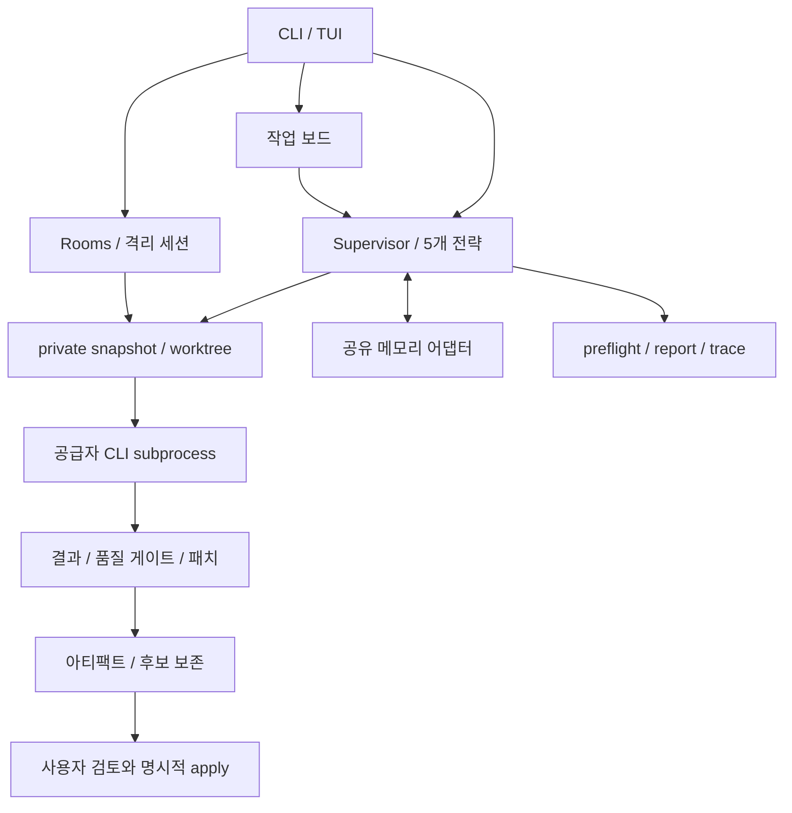

# SyncMill 현재 구현 종합 리뷰

- 검토일: 2026-09-07 (Asia/Seoul)
- 대상: `main`, `75b1a7d0dd3535d982b792634d10250f86880fe7`, 패키지 `0.1.4`
- 범위: 현재 checkout의 추적된 소스·테스트·계약·문서·CI. 미병합 MillFlow 브랜치와 미추적 `.worktrees/` 내용은 제외했다.
- 목적: 유지보수자가 결함 수정 순서와 추가 검증 범위를 결정할 수 있는 근거 제공.
- 최초 리뷰 산출물: 보고서만 추가했다. 이후 승인된 R1–R6 개선의 구현·검증 결과는 아래 후속 기록에 구분했다.

## 후속 구현 기록 — R1–R6

2026-09-07 승인된 개선 계획을 현재 작업 트리에 구현했다. 아래 1–6절과 부록은
`75b1a7d0`에 대한 최초 관찰·재현 기록이며, 코드 줄 번호와 원격 CI 결과도 해당
기준 커밋에 속한다. 수정 후 근거는 이 절과 새 회귀 테스트로 구분한다.

| 항목 | 구현한 동작 | 수정 후 근거 |
|---|---|---|
| R1 | snapshot의 `sweepable`을 pool까지 전달한다. 장기 session/room에는 실행 PID sentinel을 쓰지 않으며 기존 sentinel이 있어도 일반 sweep·retained 목록·discard에서 제외한다. | legacy marker·상대 경로 discard 회귀, 실제 tmux 생성 프로세스 종료 후 sweep 및 checkpoint 성공 |
| R2 | 임시 index에서 파일 목록·binary patch를 함께 수집한다. Git 실패/timeout은 `PatchCaptureError`; 완료 결과의 `patch=None` 저장은 거절한다. Supervisor는 실패 결과와 recovery 경로를 반환하고 workspace를 보존한다. | 실제 index lock을 남겨도 index 불변·patch 복원 성공, 수집 오류 주입 시 `recovery_required`, Rooms 후보 미게시, session checkpoint 실패 회귀 |
| R3 | macOS/Linux 실행 지원을 명시하고 Windows는 CLI와 실행·상태 저장·workspace 정리 진입점에서 거절한다. root help/version은 허용한다. | Windows 모의 환경에서 PID signal·artifact 생성·subprocess 시작 없이 거절 |
| R4 | HEAD/index의 gitlink mode `160000`으로 모든 submodule 저장소를 snapshot 생성 전에 거절한다. | clean/dirty/uninitialized submodule 및 staged 추가·삭제 검사, gitlink 없는 `.gitmodules`는 허용 |
| R5 | apply 검증을 일반 `CommandGate`에 연결한다. PWD·Git routing·monitor/run 식별자 격리, 명령 오류·출력 decoding·timeout 정책을 공유하며 첫 실패에서 중단한다. | 오염된 환경과 비 UTF-8 출력 검증, 잘못된 검증 명령 후 원본 fingerprint와 pending artifact 유지 |
| R6 | provider 호출별 stdout/stderr 합산 32 MiB 상한을 sync/async/tee에 적용한다. 초과 시 프로세스 그룹 종료·실패 기록. gate는 읽는 동안 출력 tail만 보관한다. | 정확한 상한·1 byte 초과·환경변수 설정, 무한 출력과 자손 종료, 16 MiB gate 출력의 Python 할당 peak < 4 MiB |

**R3 정정:** 최초 보고서의 board `fchmod` 언급은 보호 조건을 누락했다.
`_prepare_private_board`는 이미 `os.name != "posix"`에서 반환하므로 그 호출은
무방비한 Windows 경로가 아니다. 실제 문제는 workspace PID 검사와 artifact 쓰기였다.
승인된 해결책은 Windows 이식이 아닌 지원 범위 제한이다. 실제 Windows 기능 검증은
수행하지 않았으며, 모의 환경의 안전한 실행 거절만 검증한다.

**인터페이스:** `RepositorySnapshot.sweepable=False`, `CapturedChanges`,
`PatchCaptureError`, `AgentConfig.output_max_bytes`를 추가했다. AgentRunner 호출 규약과
수동 review/apply 흐름은 유지한다. `SYNCMILL_CODEX__OUTPUT_MAX_BYTES` 등 기존 중첩
환경변수 규칙으로 agent별 상한을 변경할 수 있다. 0/음수는 거절한다.

**최종 검증 기록 (macOS, 2026-09-07):**

- 전체 suite: `.venv/bin/python -m pytest -o addopts='' -q -ra --tb=short` → **2,314 passed, 27 skipped**, 310.43초. 선택 backend/provider와 opt-in 시나리오의 skip을 통과로 계산하지 않았다.
- 실제 process·PTY·tmux: 아래 명령 → **94 passed**, 38.53초. 기본 suite와 겹치는 테스트가 있으므로 두 숫자를 합산하지 않는다. 생성 프로세스 종료 후 실제 tmux 세션의 sweep 생존·checkpoint 회귀가 포함된다.
- Ruff: `.venv/bin/ruff check --no-cache src tests scripts examples` → 통과. `git diff --check` → 통과.
- 문서 검사 15건과 clean/dirty/uninitialized submodule 3건의 별도 실행 → **18 passed**. 전체 suite에서도 통과했다. 미추적 리뷰 보고서의 상대 파일 링크 **34개**는 별도로 확인했다.
- `uv build --offline --out-dir /private/tmp/syncmill-hardening-dist-20260907` → wheel·sdist 생성 성공. wheel 내부의 새 플랫폼 검사 모듈과 출력 상한 설정도 확인했다.
- 샌드박스의 `ps` 조회·Unix socket·tmux 권한 거절은 제품 결함과 구분했다. 해당 경로와 최종 전체 suite는 승인된 샌드박스 밖 실행으로 검증했다.

```sh
SYNCMILL_TEST_TUI_PROCESS=1 SYNCMILL_TEST_TUI_PTY=1 \
SYNCMILL_TEST_TMUX=1 SYNCMILL_TEST_ROOM_VIEWER_TMUX=1 \
.venv/bin/python -m pytest -o addopts='' -q -ra --tb=short \
  tests/test_tui_jobs.py tests/test_tui_pty.py \
  tests/test_isolated_session_tmux.py tests/test_room_viewer.py
```

최종 실행 로그는 `/private/tmp/syncmill-hardening-full-final.log`와
`/private/tmp/syncmill-hardening-optin-final.log`에 보관했다. 원격 CI는 최초 리뷰의
기준 커밋에 대한 결과이며, 이 작업 트리 변경의 원격 검증으로 사용하지 않는다.

회귀 코드는 [보강 회귀 테스트](../tests/test_implementation_hardening.py),
[실제 tmux 세션 테스트](../tests/test_isolated_session_tmux.py), 기존 agent·strategy·room·
workflow 테스트에 포함한다. 원래 부록은 수정 전 재현을 보존한 자료이며, 수정 후 판정에는
위 테스트를 사용한다. 실제 provider 호출·선택 backend 통합·새 원격 CI는 이번 검증 범위에
포함하지 않는다.

## 1. 종합 판단

**실행 결과를 검토한 뒤 명시적으로 적용하는 구조와 다층 복구 장치는 잘 갖춰져 있다. 그러나 작업 보존 경계에서 재현된 두 결함을 먼저 해결해야 한다.** 격리 세션의 작업 공간이 일반 실행의 정리 대상에 들어가며, 정상 종료한 에이전트의 패치 추출이 실패하면 변경분을 버리고 `no_changes`로 기록할 수 있다. 두 문제 모두 테스트 통과와 별개로 발생한다.

기본 pytest는 종료 코드 0으로 완료했고, 추가 프로세스·PTY·tmux 검증은 권한 재실행에서 **93 passed**였다. 현재 커밋의 원격 CI도 7개 작업 모두 성공했다. 이는 기존 회귀 시나리오의 검증 결과이며, 새로 재현한 결함이나 Windows 지원·실제 공급자 품질까지 검증했다는 뜻은 아니다.

| 우선순위 | ID | 발견 사항 | 근거 수준 |
|---|---|---|---|
| P1 | R1 | 일반 실행의 sweep이 열린 격리 세션 작업 공간을 삭제 | 실제 snapshot/store/sweep 재현, tmux 시작만 대체 |
| P1 | R2 | 패치 추출 실패를 변경 없음으로 저장하고 작업 공간 삭제 | 실제 Git index lock과 전체 Supervisor 경로 재현 |
| P1 | R3 | Windows 경로에 파괴적인 생존 확인과 Unix 전용 파일 권한 호출 잔존 | 정적 확인 + 공식 명세 + API 부재 모사 |
| P2 | R4 | 깨끗하고 초기화된 submodule을 허용하지만 에이전트 작업 공간에는 내용 누락 | 실제 로컬 Git submodule 재현 |
| P2 | R5 | `apply --verify`가 일반 품질 게이트와 다른 환경을 상속 | 실제 검증 subprocess와 대조군 재현 |
| P2 | R6 | 출력 보관 제한이 subprocess 수집 메모리 사용량을 제한하지 못함 | 합성 출력 실측 + sync/async 경로 정적 확인 |

P0는 즉시 사용 중단이 필요한 광범위한 문제, P1은 관련 기능의 다음 배포 전에 해결할 문제, P2는 조건부 정확성·안정성 문제, P3는 낮은 영향의 개선으로 사용했다. 이번 검토에서 P0를 확인하지 못했으며, 이는 P0가 존재하지 않는다는 증명은 아니다.

## 2. 구현 구조와 평가 범위

추적된 Python 구현은 43개 파일, 34,131줄이다. 주석과 docstring을 포함한 물리적 줄 수로, 복잡도나 품질 점수로 사용하지 않았다. pytest 수집 대상은 2,307개였으며, 선택 의존성 때문에 모듈 단위로 제외되는 테스트는 이 숫자로 검증됐다고 보지 않았다.



| 관점 | 확인한 장점 | 한계·후속 검증 |
|---|---|---|
| 핵심 실행 | 전략이 worktree 배치를 담당하고 Supervisor가 수명·저장·정리를 담당한다. 순차 실행과 fan-out의 구분이 명확하다. | 전략의 패치 실패 계약과 mandatory artifact 계약이 충돌한다(R2). |
| 전략·선택·호출 계획 | 5개 전략과 공통 gate/selection 경로가 있으며, judge 추가 호출과 순차 전략의 `selection=n/a`를 계획에 반영한다. | 실제 공급자 비용·품질의 우위나 재시도 전체 비용을 측정한 리뷰는 아니다. |
| Git·데이터 보존 | source fingerprint, private clone, 명시적 apply, 저장 실패 시 recovery retention을 제공한다. | 장기 세션 수명과 sweep 소유권(R1), submodule 재현성(R4)을 보완해야 한다. |
| 보드·동시성 | SQLite transaction과 lease run ID 조건부 갱신으로 이전 실행의 상태 덮어쓰기와 shared 게시를 차단한다. | heartbeat 갱신 실패가 공급자 호출을 즉시 중단하는 것은 아니다. 불필요한 실행 비용의 경계는 별도다. |
| Rooms·세션 | 후보 binding·digest, revision 확인, apply 상태 전이, durable 작업 기록과 선택 확인이 있다. | 같은 worktree 기반 기능이라도 수명 보호가 다르다. Rooms는 retain 표식을 쓰지만 격리 세션은 그렇지 않다(R1). |
| 메모리·마이그레이션 | backend adapter 분리, advisory degradation, board-run scope, target binding·digest·rollback 보호가 있다. | 실제 backend smoke와 장기간 다중 프로세스 검증은 이번에 실행하지 않았다. |
| 보안·통제 | argv 기반 실행, Git routing 환경 제거, read-only MCP, strict preflight 실패 시 차단이 구현돼 있다. | worktree는 OS sandbox가 아니다. 공급자 프로세스 전체의 권한이나 모든 내부 tool call을 강제 통제한다고 볼 수 없다. |
| 성능·자원 | subprocess 종료·drain 제한, 로그 rotation, terminal artifact retention, 화면별 polling 최적화가 있다. | 수집 중 출력 메모리(R6), 대규모 pending 기록·보드의 스캔 비용은 별도 관리가 필요하다. |
| CLI/TUI·문서 | 명시적 apply, limited/degraded 상태, detached 작업 재접속, EN/KO 가이드와 문서 회귀 검사가 있다. | subprocess 환경 공통화가 불완전하다(R5). 실사용 화면 직접 조작·스크린샷 QA는 수행하지 않았다. |
| 배포·검증 | Python 3.12–3.14 CI, Linux/macOS tmux CI, 소스 배포와 wheel 빌드가 확인됐다. | Windows CI와 optional backend/외부 서비스 검증, wheel의 신규 환경 설치 검증은 별도다. |

## 3. 우선순위별 발견 사항

### R1 — P1: 열린 격리 세션을 일반 실행의 sweep이 삭제한다

**위치:** [WorktreePool 생성·표식 기록](../src/syncmill/worktree.py#L511-L516), [acquire의 표식 갱신](../src/syncmill/worktree.py#L545-L549), [격리 세션 생성](../src/syncmill/isolated_session.py#L266-L320), [sweep](../src/syncmill/worktree.py#L693-L710).

`capture_repository_snapshot(..., sweepable=False)`는 Rooms와 격리 세션을 일반 sweep에서 제외하려는 인터페이스다. 그러나 `WorktreePool.__init__`와 `acquire`는 snapshot 종류와 관계없이 `.syncmill-run`에 생성 프로세스 PID를 기록한다. `IsolatedSessionStore.create`는 `open` 기록을 남기고 반환하지만 recovery 표식을 추가하지 않는다. 나중에 일반 `run` 등이 sweep을 실행하면 **세션을 만든 CLI 프로세스의 종료**를 **세션 작업 공간의 폐기 가능 상태**로 취급한다.

**재현:** 별도 Python 프로세스에서 임시 저장소의 격리 세션을 생성하고 `unsaved.txt`를 추가했다. tmux 시작 함수만 대체하고 실제 snapshot·worktree·세션 기록을 사용했다. 생성 프로세스 종료 뒤 부모 프로세스에서 실제 sweep을 호출했다.

```text
stored_state=open
run_sentinel=true, recovery_marker=false
sweep_removed=1
session_workspace_exists=false
```

**영향:** 세션이 checkpoint하지 않은 편집 내용을 잃고, 세션 기록은 삭제된 경로를 가리킬 수 있다. 실제 tmux 세션이 계속 실행 중인 상태까지 결합한 재현은 이번에 수행하지 않았지만, sweep이 tmux·세션 기록을 조회하지 않고 생성 PID만 검사하는 경로는 확인했다. Rooms는 정상 초기화 이후 `pool.retain()`을 호출하므로 동일한 정상 완료 사례로 일반화하지 않는다.

**수정 방향:** snapshot/pool에 sweep 소유권을 명시적으로 전달하고, `sweepable=True`인 일반 실행·검증 작업만 표식을 생성·갱신해야 한다. 격리 세션 수명은 session store의 close/recovery가 담당해야 한다. 모든 장기 세션을 recovery artifact로 표시하는 임시 처방보다 소유권 분리가 정확하다.

**회귀 기준:** 세션 생성 부모가 종료된 뒤에도 일반 sweep이 open 세션의 파일과 Git metadata를 보존해야 한다. 이후 session checkpoint/close가 정상 동작해야 한다. 일반 실행의 죽은 소유자 정리와 apply-verify 잔여물 정리는 계속 작동해야 한다.

### R2 — P1: 패치 추출 실패가 성공·변경 없음으로 바뀌고 작업을 잃는다

**위치:** [패치 추출 실패 반환](../src/syncmill/strategies/base.py#L187-L203), [저장 상태 결정](../src/syncmill/artifacts.py#L593-L596), [Supervisor 저장과 실패 처리](../src/syncmill/supervisor.py#L809-L861), [작업 공간 정리](../src/syncmill/worktree.py#L593-L605).

`_git_diff_patch`는 `git add` 또는 diff 실패를 `None`으로 반환한다. `ArtifactStore.save`는 `None`과 정상적인 빈 패치를 모두 빈 bytes로 바꾼다. 따라서 `TaskStatus.COMPLETED`인 결과는 `no_changes`로 저장되고, 저장 예외가 없으므로 Supervisor가 recovery retention을 실행하지 않는다.

**재현:** 가짜 공급자가 실제 private worktree에 `winner.txt`를 생성한 후 실제 `index.lock` 파일을 남겼다. 이후 패치 추출·저장·정리는 대체하지 않고 전체 Supervisor 경로를 실행했다.

| 조건 | 결과 | 파일 목록 | 저장 상태 | 패치 크기 | 작업 공간 보존 |
|---|---|---|---|---|---|
| 정상 대조군 | completed | winner.txt | pending | 141 bytes | 정상 정리, 패치 보존 |
| index.lock 존재 | completed | winner.txt | no_changes | 0 bytes | 삭제, recovery 없음 |

원본 checkout에는 두 경우 모두 `winner.txt`가 없었다. 실패 사례는 다른 저장 경로에 패치가 남지 않아 검토·apply를 할 수 없다. interrupted Git 작업, 권한 문제, diff timeout 등도 같은 실패 반환 계약을 사용한다.

**수정 방향:** 성공한 빈 패치와 추출 실패를 다른 결과로 유지한다. mandatory 결과 수집 실패는 명시적 실패/복구 필요 상태로 전파하고 작업 공간을 보존한다. `files_changed`가 비었는지만으로 성공을 판단해서는 안 된다. 파일 목록 수집 자체도 실패를 빈 목록으로 반환할 수 있기 때문이다.

**회귀 기준:** 정상 no-op, 새 파일, binary/non-UTF-8 패치, index lock, Git nonzero/timeout을 구분한다. 실패 시 성공 메시지·`no_changes`·공유 성공 요약을 남기지 않고 복구 경로를 제공해야 한다. 기본 전략별 공통 수집 경로를 검증한다.

### R3 — P1: Windows foreground 경로에 POSIX 전제가 남아 있다

**위치:** [worktree 생존 검사](../src/syncmill/worktree.py#L631-L642), [일반 실행의 sweep 호출](../src/syncmill/cli.py#L2186-L2188), [artifact atomic write](../src/syncmill/artifacts.py#L252-L259). 비교 대상은 이미 플랫폼 분기를 둔 [artifact worker 검사](../src/syncmill/artifacts.py#L167-L171)와 [권한 helper](../src/syncmill/teamfile.py#L396-L411)다.

두 가지 플랫폼 전제가 확인됐다.

1. `_process_is_alive`는 플랫폼 분기 없이 `os.kill(pid, 0)`을 호출한다. Python 공식 명세에서 Windows의 일반 signal 값은 `TerminateProcess`를 사용하며, `0`은 POSIX처럼 안전한 생존 조회가 아니다. 존재하는 PID를 검사하려다가 종료할 수 있다. [Python 3.12 os.kill 명세](https://docs.python.org/3.12/library/os.html#os.kill)
2. mandatory artifact의 `_atomic_write`는 Unix 전용 `os.fchmod`를 직접 호출한다. 해당 API가 없는 환경을 모사하면 `AttributeError: module 'os' has no attribute 'fchmod'`로 실패했다. 신규 board 파일 준비의 같은 호출은 POSIX 조건문으로 보호되어 있다(후속 검토 정정). [Python 3.12 os.fchmod 명세](https://docs.python.org/3.12/library/os.html#os.fchmod)

**영향과 확신 수준:** Windows foreground 실행·보드 사용의 지원 계약에 문제가 있다. API 부재는 로컬 모사했고, 파괴적 signal 동작은 공식 명세와 코드로 판정했다. 실제 Windows에서 프로세스를 종료시키는 실험은 수행하지 않았다. macOS/Linux의 동일 함수가 같은 방식으로 프로세스를 종료한다는 뜻은 아니다.

**수정 방향:** 이미 존재하는 read-only Windows process probe와 이식 가능한 파일 권한 설정을 공통 helper로 옮겨 모든 호출부가 사용하게 한다. import 경로와 foreground 시작·저장·정리를 Windows CI에서 검증하고, 지원되지 않는 surface는 실행 전 명시적으로 거절한다.

**회귀 기준:** Windows에서 살아 있는 자식 프로세스 조회 후 그 프로세스가 계속 살아 있어야 한다. dead/권한 거절 PID 처리와 새 artifact/board 생성이 정상 동작해야 한다. POSIX 프로세스 그룹 취소 테스트도 유지한다.

### R4 — P2: clean submodule의 내용이 snapshot 작업 공간에서 누락된다

**위치:** [submodule 사전 검사](../src/syncmill/worktree.py#L303-L320), [private clone](../src/syncmill/worktree.py#L343-L345), [에이전트 worktree 생성](../src/syncmill/worktree.py#L554-L563).

원본 submodule이 초기화돼 있고 깨끗하면 snapshot을 허용하지만, private clone과 worktree 생성 경로에는 해당 submodule 내용을 복원하는 단계가 없다.

**재현:** 임시 로컬 저장소를 다른 저장소의 submodule로 추가·커밋했다. 실제 `capture_repository_snapshot`과 `WorktreePool.acquire` 실행 결과는 다음과 같다.

```text
source_has_file=true
agent_has_file=false
agent_submodule_status=-<commit> sub
```

**영향:** 에이전트와 gate가 원본에서 존재하는 소스·의존 파일을 보지 못한다. 해당 프로젝트에서 분석 결과나 빌드 실패가 잘못된 snapshot에 기인할 수 있다. dirty submodule을 거절하는 기존 테스트는 clean submodule 재현성까지 보장하지 않는다.

**수정 방향:** 단기적으로 submodule이 있는 저장소를 실행 전에 명확하게 거절한다. 지원을 구현할 때는 재귀 content materialization, 네트워크 정책, 원본 `.git/modules`와의 격리, gitlink 변경·패치 적용까지 하나의 계약으로 정의해야 한다. 단순히 clone flag만 추가한 것으로 완료 처리하지 않는다.

**회귀 기준:** clean/dirty/uninitialized/nested submodule을 구분한다. 지원하는 경우 원본과 에이전트 작업 공간의 파일 내용·commit이 일치하고 원본 metadata가 변하지 않아야 한다.

### R5 — P2: apply 검증 subprocess에 부모 실행 ID와 잘못된 PWD가 전달된다

**위치:** [apply 검증 환경](../src/syncmill/artifacts.py#L1115-L1122), [일반 gate 환경](../src/syncmill/gates.py#L39-L49), [공통 subprocess 환경](../src/syncmill/agents.py#L199-L208), [monitor 감지](../src/syncmill/monitor.py#L129-L145).

일반 `CommandGate`는 `_isolated_process_env`로 `PWD`를 실제 worktree에 맞추고 `SYNCMILL_MONITOR_DIR`, `SYNCMILL_RUN_ID`, `OLDPWD`, `CDPATH`를 제거한다. `apply --verify`는 `isolated_git_env`만 사용하므로 이 처리가 없다.

**재현:** 임시 monitor 표식과 `parent-run-id`를 설정하고, 같은 Python 검증 명령을 일반 gate와 apply 검증에서 각각 실행했다. 검증 자식은 실제 cwd·PWD와 `resolve_run_id()` 결과를 기록했다.

| 경로 | PWD와 실제 cwd 일치 | 부모 run ID 채택 | monitor 환경 전달 |
|---|---|---|---|
| 일반 gate | true | false | false |
| apply 검증 | false | true | true |

**영향:** 환경변수 `PWD`를 신뢰하는 도구는 원본 경로를 사용할 수 있다. 검증 도구가 다시 SyncMill을 호출하고 유효한 부모 monitor 표식이 남아 있다면 부모 실행으로 오인할 수 있다. 부모 결과 파일 덮어쓰기까지 실행한 재현은 아니며, **그 원인인 실행 ID 채택까지** 재현했다.

**수정 방향:** apply 검증에도 일반 gate와 같은 환경 builder를 사용한다. 별도 구현된 검증 명령 파싱·UTF-8 오류 처리도 같은 계약으로 정리한다. 이 과정에서 공급자 인증 환경 전체를 임의로 제거하는 정책 변경은 별도 결정 사항이다.

**회귀 기준:** stale PWD/OLDPWD/CDPATH, Git routing 변수, 유효한 monitor 표식과 실행 ID를 주입한 대조 테스트를 추가한다. child cwd/PWD가 verification worktree에 고정되고 child run ID가 독립적이어야 한다.

### R6 — P2: 로그·결과 tail 제한이 메모리 상한으로 작동하지 않는다

**위치:** [sync subprocess 수집](../src/syncmill/agents.py#L89-L129), [async 수집](../src/syncmill/agents.py#L794-L804), [tee의 누적 버퍼](../src/syncmill/agents.py#L1412-L1428), [gate의 사후 tail](../src/syncmill/gates.py#L140-L146).

sync 경로는 `communicate`로 전체 출력을 모으고, async tee도 모든 chunk를 list에 보관한 뒤 join한다. gate의 4,000자 제한과 Room 출력 파일 제한은 수집 이후 적용된다. 디스크 rotation이 있어도 부모 프로세스 메모리에는 전체 출력이 남을 수 있다.

**실측:** 실제 Python 자식이 stdout으로 ASCII를 출력하고, `CommandGate.evaluate` 동안 부모의 `tracemalloc` peak를 측정했다.

| 자식 stdout | 저장된 gate output | 부모 Python 할당 peak |
|---|---|---|
| 1 MiB | 4,000자 | 3.01 MiB |
| 16 MiB | 4,000자 | 48.03 MiB |

이 수치는 해당 합성 gate 실행의 Python 할당량이며 RSS·실제 공급자 transcript·운영 최대 부하 측정이 아니다. 그러나 출력량에 비례한 누적과 복사 비용은 확인됐다. 다중 agent와 장시간 test/build 출력이 겹치면 메모리 압력이 커질 수 있다.

**수정 방향:** gate는 수집 중 bounded tail을 유지한다. 공급자 JSON/JSONL은 프로토콜에 맞는 streaming parser 또는 제한된 spool을 사용하고, 상한 초과 시 성공으로 오인하지 않는 명시적 실패/불완전 상태를 기록한다. 단순 앞부분 자르기는 정상 종료·usage·오류 이벤트를 잃을 수 있으므로 피한다.

**회귀 기준:** 작은/큰 stdout·stderr, 마지막 error event, malformed/partial JSONL, timeout·취소를 함께 검증한다. gate retained output뿐 아니라 수집 버퍼 상한을 확인한다.

## 4. 추가 평가: 결함과 구분할 설계 선택·검증 공백

### 아키텍처와 유지보수

전략 registry와 공통 selection/gate 경로는 확장이 쉽고, 공급자 실행과 메모리 저장 계약이 구분돼 있다. 반면 `Supervisor.run`은 617줄, `RoomCoordinator.run_round`는 333줄, `_apply_locked`는 259줄이다. 길이 자체보다 수명·저장·환경 처리의 중복이 실제 R1/R2/R5로 연결된 점이 중요하다. 대규모 패키지 재편보다 sweep ownership, patch capture result, verification subprocess 환경의 작은 공통 계약을 먼저 정리하는 편이 근거에 맞다.

`model_routing.build_decision`의 auto는 추천만 기록하고 explicit tier만 적용한다. 결정적 휴리스틱은 재현성이 높지만 의미적 난이도·비용 최적화 성능을 검증한 분류기가 아니다. board 경로에서 routing이 비활성화되는 범위도 문서의 지원 surface와 함께 유지해야 한다. [모델 결정](../src/syncmill/model_routing.py#L266-L317)

### 메모리와 협업 의미

메모리 장애를 경고하고 실행을 계속하는 정책은 단일 태스크의 가용성에 유리하다. 다만 council/decompose의 협업은 relevance-ranked shared context에 의존하며, 모든 상대 결과나 변경 코드가 반드시 전달되는 것은 아니다. decompose의 통합은 자동 코드 병합이 아니라 요약을 읽은 재합성이라는 현재 설계로 평가했다.

30초 memory timeout은 cancellation-cooperative async 호출에 대한 제한이다. loop를 막는 동기 코드나 취소를 무시하는 backend에 대한 절대 시간 보장이 아니라는 점이 코드에 명시돼 있다. 따라서 이를 즉시 timeout 버그로 추가 집계하지 않았다. memtomem의 agent 출력 내부 Markdown heading 처리에 관한 잔존 제한도 코드에 명시돼 있으며, 실제 backend 재현 없이 새 결함으로 집계하지 않았다. [메모리 제한](../src/syncmill/memory.py#L643-L691)

migration은 source digest 재확인, destination binding, 항목별 state 기록, 변경된 target rollback 거절을 구현한다. backend 쓰기와 로컬 state 기록을 하나의 분산 transaction으로 만드는 구조는 아니므로 실제 adapter의 idempotency와 실패 후 재시도는 real smoke에서 확인해야 한다. 이번에는 fake SDK 기반 회귀만 검증했다. `_load`의 v1 허용은 이후 단계에서 구체적인 legacy 안내를 내기 위한 것으로 주석이 설명하므로, 기존 backlog의 해당 항목을 실행 가능한 v1 지원 버그로 해석하지 않았다. [migration 검증](../src/syncmill/memory_migration.py#L794-L812)

### 보안·운영 경계

HTTP MCP의 무인증·loopback 기본값과 non-loopback 경고는 문서화된 설계다. 무인증 자체를 새로운 우회 취약점으로 집계하지 않았다. 외부 공개 시에는 저장소의 안내대로 인증된 proxy 등 별도 접근 통제가 필요하다. gateway의 shared namespace 제한과 읽기 전용 tool 목록은 테스트가 검증하지만, backend의 내부 maintenance까지 읽기만 수행한다고 확대 해석하지 않는다. [gateway 안내](../README.md#read-only-mcp-gateway-syncmill-serve)

preflight strict 모드는 선택 identity와 정책 결과를 검증하고 내부 오류도 차단으로 처리한다. 이는 subprocess가 내부에서 실행하는 모든 도구를 중재한다는 보장이 아니다. report의 body-free envelope와 별도 `result.json`의 실제 출력도 구분해야 한다. report 디렉터리 전체를 body-free 데이터로 취급하면 안 된다. [preflight](../src/syncmill/preflight.py#L95-L133), [report 계약](../src/syncmill/report.py#L20-L31)

atomic writer의 파일 fsync·rename은 프로세스 중단 복구에 유용하다. artifact writer는 teamfile writer와 달리 parent directory fsync를 하지 않으므로, 이번 프로세스 crash 테스트 결과를 정전·파일시스템 장애 시 durability 보장으로 확대하지 않았다. 실제 power-loss 검증은 수행하지 않았다.

### 성능·사용성

TUI는 활성 탭과 Runs 하위 pane만 주기 갱신하는 최적화가 있다. 다만 artifact 목록은 해당 pane에서 모든 manifest를 읽고 정렬하며, 보드 `next_runnable`은 `BEGIN IMMEDIATE` 안에서 후보 rows를 `fetchall`한다. `stats`도 전체 work item을 materialize한다. terminal retention과 transition compaction이 도움이 되지만, pending/recovery 상태는 보존해야 하므로 전체 규모가 자동으로 제한되지는 않는다. 대량 기록에서 pagination·요약 index를 검토할 근거는 있으나, 이번에는 UI 지연이나 처리량 회귀를 실측하지 않아 확정 결함으로 집계하지 않았다. [artifact 목록](../src/syncmill/artifacts.py#L684-L698), [보드 선택](../src/syncmill/board.py#L653-L677)

실사용 관점에서는 “provider 완료”, “검증 통과”, “패치 보존”, “원본 적용”이 각각 구분돼야 한다. 현재 명시적 apply UX는 이 방향과 맞지만 R2처럼 내부 수집 실패가 성공으로 보이면 사용자의 판단 기반이 무너진다. 표시 문구 변경보다 상태 계약 수정을 우선해야 한다.

## 5. 실행한 검증과 증거

| 검증 | 명령·환경 | 결과 |
|---|---|---|
| 기준 상태 | `git rev-parse HEAD`, `git status --short` | 위 SHA. 기존 미추적 `.worktrees/` 보존 |
| 도구 | Python 3.12.11, pytest 9.0.3, Ruff 0.15.22, macOS | 기존 `.venv` 사용 |
| 주요 설치 패키지 | mcp 2.0.0, memtomem 0.4.0, textual 8.2.8, pydantic 2.12.5 | 로컬 metadata 조회 |
| 테스트 수집 | `.venv/bin/python -m pytest --collect-only -o addopts='' -q` | 2,307개 수집 |
| 기본 회귀 | `.venv/bin/python -m pytest -q` | exit 0, 선택 integration skip 포함. 이 명령의 중복 quiet 설정으로 pass 개수 요약은 출력되지 않음 |
| 정적 검사 | `.venv/bin/ruff check --no-cache src tests scripts examples` | 통과 |
| 프로세스/PTY/tmux | 아래 opt-in 명령 | 최초 sandbox 실패, 권한 재실행 **93 passed in 35.35s** |
| 별도 재현 | 부록 A의 가짜 공급자·임시 Git 저장소 probe | R1/R2/R4/R5 재현 |
| 플랫폼 모사 | `os.fchmod` 부재 상태의 artifact atomic write | AttributeError 재현. Windows 실기기 검증 아님 |
| 출력 측정 | 부록 B의 CommandGate + tracemalloc | R6 표의 1/16 MiB 결과 |
| 배포 패키지 | `uv build --offline --out-dir /private/tmp/syncmill-review-dist-20260907` | sdist와 wheel 생성 성공 |
| 원격 CI | 현재 SHA의 GitHub Actions 실행 조회 | 7개 작업 모두 success |
| 보고서 검증 | 문서 회귀·링크/행 범위·부록 코드 재실행 | 15 passed, 로컬 링크 32개 유효, Python 부록 2개 재현 결과 일치 |

추가 프로세스 검증 명령:

```bash
SYNCMILL_TEST_TUI_PROCESS=1 SYNCMILL_TEST_TUI_PTY=1 \
SYNCMILL_TEST_TMUX=1 SYNCMILL_TEST_ROOM_VIEWER_TMUX=1 \
.venv/bin/python -m pytest -o addopts='' -q -ra --tb=short \
  tests/test_tui_jobs.py tests/test_tui_pty.py \
  tests/test_isolated_session_tmux.py tests/test_room_viewer.py
```

최초 sandbox 실행에서는 Unix socket `bind`가 `Operation not permitted`로 차단됐고 tmux 관련 실패도 발생했다. 권한 재실행에서 모두 통과했으므로 이 최초 실패들을 코드 결함으로 집계하지 않았다. 추가 93개는 기본 suite와 겹치므로 별개 테스트 수로 합산하지 않는다.

원격 증거는 [CI 실행 33604029658](https://github.com/memtomem/syncmill/actions/runs/33604029658)이다. 2026-09-02 생성된 현재 HEAD의 실행을 2026-09-07에 재조회했다. `lint`, `test (3.12/3.13/3.14)`, `posix-process`, `tmux (ubuntu-latest/macos-latest)`가 모두 성공했다. 중간 네트워크 조회 실패는 재조회로 해소했으며 CI 실패로 해석하지 않았다.

**미실행:** 유료 공급자 호출, real memtomem/mem0/LangGraph migration smoke, Phoenix 실연동, Windows runtime, 운영 데이터 규모 부하 시험, 취약점 DB 전체 스캔, 신규 환경 wheel 설치, 화면 직접 조작 QA. 기본 환경에서 Phoenix 테스트는 선택 의존성/opt-in 조건으로 제외된다. 이번 보고서는 실서비스 품질·전체 dependency CVE 부재·생산 환경 승인 보고서가 아니다.

## 6. 개선 순서와 완료 조건

1. **작업 보존부터 수정:** R1의 sweep ownership과 R2의 패치 실패 전달을 각각 수정한다. 새 재현을 정식 회귀로 넣고 정상 정리·명시적 close·no-op 동작을 함께 확인한다.
2. **플랫폼 계약 정리:** R3의 PID 조회와 권한 설정을 공통화한다. Windows foreground smoke가 없으면 지원 범위를 확대해 설명하지 않는다.
3. **실행 재현성 보완:** R4는 명시적 미지원 거절부터 적용하고, R5는 일반 gate 환경과 일치시킨다. submodule 지원 추가는 독립 기능으로 설계한다.
4. **출력 수집 상한 추가:** R6은 gate bounded tail부터 처리하고, 공급자별 parser 변경은 오류 이벤트·usage·취소 회귀를 포함해 단계적으로 진행한다.
5. **증거 확장:** 실제 backend·공급자 canary와 대형 보드/TUI 측정을 별도 실행한다. 기존 suite 통과, 실제 연동, 사용성, 운영 준비를 각각 기록한다.

이번 리뷰에서는 구현을 수정하지 않았으므로 R1–R6은 모두 미해결 상태다. 보고서의 발견 사항은 현재 SHA와 재현 조건에 한정된다.

## 부록 A. 재현 코드

저장소 루트에서 아래 Python 코드를 `/private/tmp/syncmill-review-probes.py`로 저장한 뒤 `.venv/bin/python /private/tmp/syncmill-review-probes.py`로 실행한다. 기존 테스트 fake/helper를 재사용하므로 소스 checkout이 필요하다. 모든 Git 변경은 자동 정리되는 임시 저장소에서 발생하며, 실제 공급자·운영 메모리는 호출하지 않는다. 세션 probe는 tmux 시작만 대체한다. UUID·commit hash·임시 경로는 실행마다 달라진다.

```python
import json
import os
import shlex
import subprocess
import sys
import tempfile
from pathlib import Path
from unittest.mock import patch

REPO = Path.cwd()
sys.path.insert(0, str(REPO / 'tests'))
from conftest import FakeAgent, FakeMemory, FakeRegistry
from test_supervisor import _supervisor
from syncmill.config import SyncmillConfig
from syncmill.models import Task
from syncmill.worktree import capture_repository_snapshot, WorktreePool
from syncmill.artifacts import ArtifactStore
from syncmill.gates import CommandGate
from syncmill.memory import close_event_loop


def git(repo, *args):
    return subprocess.run(['git', *args], cwd=repo, check=True,
                          capture_output=True, text=True).stdout.strip()


def repo_at(path):
    path.mkdir()
    git(path, 'init', '-q')
    git(path, 'config', 'user.email', 'review@example.invalid')
    git(path, 'config', 'user.name', 'Review')
    git(path, 'config', 'commit.gpgsign', 'false')
    (path / 'base.txt').write_text('base\n')
    git(path, 'add', '.')
    git(path, 'commit', '-qm', 'base')
    return path


with tempfile.TemporaryDirectory(prefix='syncmill-review-') as temp:
    root = Path(temp)
    # Real Git contention: no mock of patch collection, save, or cleanup.
    for locked in (False, True):
        case = root / ('locked' if locked else 'control')
        case.mkdir()
        repo = repo_at(case / 'repo')

        class EditingAgent(FakeAgent):
            def execute(self, prompt, workdir, timeout):
                self.workdir = workdir
                (workdir / 'winner.txt').write_text('valuable work\n')
                if locked:
                    lock = Path(git(workdir, 'rev-parse', '--git-path', 'index.lock'))
                    if not lock.is_absolute():
                        lock = workdir / lock
                    lock.write_text('simulated interrupted git operation\n')
                return super().execute(prompt, workdir, timeout)

        agent = EditingAgent('codex')
        cfg = SyncmillConfig(repo_root=str(repo), agent_priority=['codex'],
            workspace={'root': str(case / 'ws')}, runs={'root': str(case / 'runs')})
        sup = _supervisor(FakeRegistry([agent]), FakeMemory(), config=cfg)
        result = sup.run(Task(prompt='make winner'))
        manifest = json.loads((Path(result.artifact_path) / 'manifest.json').read_text())
        print(json.dumps({'probe': 'patch_capture', 'index_locked': locked,
            'status': result.status.value, 'files_changed': result.files_changed,
            'patch_is_none': result.patch is None, 'artifact_state': manifest['state'],
            'patch_bytes': manifest['patch_bytes'], 'workspace_exists': agent.workdir.exists(),
            'recovery_workspace': str(sup.recovery_workspace),
            'source_has_winner': (repo / 'winner.txt').exists()}))

    # A clean initialized submodule passes snapshot admission.
    child = repo_at(root / 'child')
    parent = repo_at(root / 'parent')
    git(parent, '-c', 'protocol.file.allow=always', 'submodule', 'add', str(child), 'sub')
    git(parent, 'commit', '-qam', 'submodule')
    snap = capture_repository_snapshot(parent, 'submodule', root / 'sub-ws')
    pool = WorktreePool(parent, 'submodule', snapshot=snap)
    wt = pool.acquire('codex')
    print(json.dumps({'probe': 'clean_submodule',
        'source_has_file': (parent / 'sub/base.txt').exists(),
        'agent_has_file': (wt.path / 'sub/base.txt').exists(),
        'agent_submodule_status': git(wt.path, 'submodule', 'status')}))
    pool.cleanup_all()

    # Compare normal quality-gate isolation with apply --verify isolation.
    repo = repo_at(root / 'verify-repo')
    monitor = root / 'fake-monitor'
    monitor.mkdir()
    (monitor / '.syncmill-inner').touch()
    probe = root / 'env_probe.py'
    probe.write_text('import os,json,sys\nfrom pathlib import Path\n'
        'from syncmill.report import resolve_run_id\n'
        'Path(sys.argv[1]).write_text(json.dumps({"cwd":os.getcwd(),'
        '"PWD":os.environ.get("PWD"),"run_id":resolve_run_id(),'
        '"monitor":os.environ.get("SYNCMILL_MONITOR_DIR")}))\n')
    observed = {}
    with patch.dict(os.environ, {'PWD': str(repo),
            'SYNCMILL_MONITOR_DIR': str(monitor), 'SYNCMILL_RUN_ID': 'parent-run-id'}):
        for kind in ('normal_gate', 'apply_verify'):
            out = root / (kind + '.json')
            command = shlex.join([sys.executable, str(probe), str(out)])
            if kind == 'apply_verify':
                ArtifactStore._verify_in_isolation(run_id='env', repo_root=repo,
                    patch=b'diff --git a/new.txt b/new.txt\nnew file mode 100644\n--- /dev/null\n+++ b/new.txt\n@@ -0,0 +1 @@\n+new\n',
                    commands=[command], timeout=20, workspace_root=root / 'verify-ws')
            else:
                snap = capture_repository_snapshot(repo, 'gate', root / 'gate-ws')
                pool = WorktreePool(repo, 'gate', snapshot=snap)
                wt = pool.acquire('codex')
                assert CommandGate([command], 20).evaluate(wt).passed
                pool.cleanup_all()
            data = json.loads(out.read_text())
            observed[kind] = {'PWD_matches_cwd': data['PWD'] == data['cwd'],
                'adopted_parent_run_id': data['run_id'] == 'parent-run-id',
                'has_monitor': data['monitor'] is not None}
    print(json.dumps({'probe': 'verify_environment', **observed}))

    # Session creator exits; durable session metadata remains open. Only tmux
    # startup is stubbed; snapshot, store, marker and sweep are real.
    repo = repo_at(root / 'session-repo')
    session_script = '''
import json,sys
from pathlib import Path
from unittest.mock import patch
from syncmill.config import SyncmillConfig
from syncmill.isolated_session import IsolatedSessionStore
root,repo=map(Path,sys.argv[1:])
config=SyncmillConfig(repo_root=str(repo),runs={"root":str(root/"session-runs")},workspace={"root":str(root/"session-ws")})
with patch("syncmill.isolated_session._create_session"):
    value=IsolatedSessionStore(config,repo).create("codex")
(Path(value["worktree_path"])/"unsaved.txt").write_text("session work")
print(json.dumps(value))
'''
    value = json.loads(subprocess.check_output(
        [sys.executable, '-c', session_script, str(root), str(repo)], text=True))
    from syncmill.worktree import sweep_orphaned_workspaces
    run_root = Path(value['run_root'])
    sentinel = (run_root / '.syncmill-run').exists()
    recovery = (run_root / '.syncmill-recovery').exists()
    removed = sweep_orphaned_workspaces(root / 'session-ws')
    print(json.dumps({'probe': 'durable_session_sweep', 'stored_state': value['state'],
        'run_sentinel': sentinel, 'recovery_marker': recovery,
        'sweep_removed': removed, 'session_workspace_exists': run_root.exists()}))
close_event_loop()
```

## 부록 B. 출력 메모리 측정 코드

저장소 루트의 `.venv/bin/python`으로 실행한다. 측정에는 Python 부모 프로세스의 추적 가능한 할당만 포함된다.

```python
import json
import shlex
import sys
import tempfile
import tracemalloc
from pathlib import Path
from syncmill.gates import CommandGate
from syncmill.worktree import Worktree

with tempfile.TemporaryDirectory(prefix="syncmill-output-probe-") as directory:
    worktree = Worktree(Path(directory), "probe", "codex", False)
    for mib in (1, 16):
        command = shlex.join([
            sys.executable, "-c",
            f'import sys;sys.stdout.write("x"*{mib}*1024*1024)',
        ])
        tracemalloc.start()
        result = CommandGate([command], 30).evaluate(worktree)
        _, peak = tracemalloc.get_traced_memory()
        tracemalloc.stop()
        print(json.dumps({
            "stdout_mib": mib,
            "passed": result.passed,
            "retained_characters": len(result.checks[0].output),
            "python_peak_mib": round(peak / 1024 / 1024, 2),
        }))
```
