# syncmill TUI 화면 안내서

이 문서는 `syncmill tui`의 **7개 탭과 11개 화면 상태를 처음부터 하나씩**
설명합니다. 설치와 첫 프로젝트 초기화가 아직이라면
[처음 사용자 가이드](user-guide.ko.md)를 먼저 따라가세요. 실제 저장소 대신
버려도 되는 환경에서 화면을 조작하려면
[`/tmp` 안전 테스트 가이드](tmp-test-guide.ko.md)를 사용하세요.

## 시작하기

TUI에는 `--repo` 옵션이 없습니다. Syncmill 소스가 아니라 **작업할 Git 저장소**로
이동한 뒤 실제 터미널에서 실행하세요.

```bash
export SYNCMILL_SRC=/path/to/syncmill
cd /path/to/my-project
uv run --project "$SYNCMILL_SRC" syncmill doctor
uv run --project "$SYNCMILL_SRC" syncmill tui --tab status
```

파이프나 IDE 출력 창처럼 stdout이 TTY가 아닌 환경에서는 열리지 않습니다.
권장 화면은 120×40 이상이며, 80×24까지 자동 테스트합니다.

### Board 켜기 (첫 성공 동선의 준비물)

Board는 **기본적으로 꺼져 있습니다.** `init` 직후 그대로 TUI를 열면 Board 탭이
LIMITED로 표시되고 `a`로 작업을 추가할 수 없습니다. 아래 동선의 2~3단계를
따라가려면 먼저 대상 저장소의 `syncmill.toml`에 다음을 추가하세요.

```toml
[board]
enabled = true
```

또는 TUI를 여는 셸에서 `export SYNCMILL_BOARD__ENABLED=true`로 켜도 됩니다.

### 화면의 공통 구조

- 위: `Board`, `Runs`, `Reports`, `Teams`, `Status`, `Sessions`, `Rooms` 탭
- 가운데: 왼쪽 목록과 오른쪽 상세 정보
- 아래: 현재 상태와 이 화면에서 실제로 사용할 수 있는 단축키
- `1`~`7`: 탭 이동
- `r`: 현재 화면 새로고침
- `?`: 도움말
- `q`: TUI만 닫기. 실행 중인 detached worker는 계속 동작하며 다시 열면 재연결

`--tab auto`는 데이터 수가 아니라 저장소가 열렸는지를 기준으로
**Rooms → Board → Runs → Status** 순서에서 첫 화면을 고릅니다. 사용할 수 없는 탭을
직접 지정하면 다른 탭으로 보내지 않고 그 탭의 복구 안내를 보여 줍니다.

상태 안내는 다음처럼 읽습니다.

- **빈 화면**: 저장소는 정상이나 아직 기록이 없음
- **LIMITED**: 기능이 설정에서 꺼졌거나 저장소를 열 수 없어 읽기·조작이 제한됨
- **DEGRADED**: 읽는 도중 오류가 생김. 가능한 경우 마지막 정상 화면을 보존

## 첫 성공 권장 동선

1. `Status`에서 설정을 확인하고, 실제 설치·로그인은 `doctor`로 확인합니다.
2. Board를 켠 상태에서(위 준비물) `Board`에 작고 확인 가능한 작업 하나를
   추가합니다.
3. `x`로 Codex 하나만 선택해 실행합니다.
4. `Runs / Operations`에서 상태와 로그를 봅니다.
5. `Runs / Artifacts`에서 Summary와 Diff를 확인합니다.
6. 정확한 run과 digest를 확인한 뒤 `g`로 원본 저장소에 적용합니다.
7. 익숙해진 다음 Sessions와 Rooms를 사용합니다.

## 1. Board

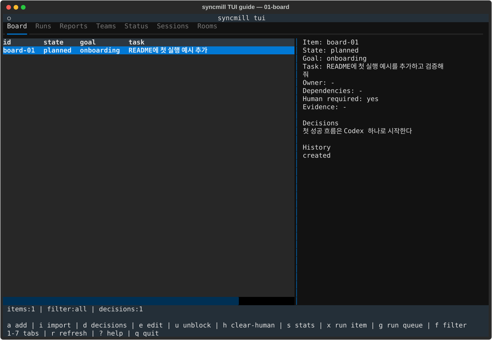

Board는 해야 할 작업, 작업 사이의 의존성, 사람 확인 여부와 실행 이력을 관리합니다.

- 왼쪽: ID, 상태, 목표, 작업 요약, 담당 agent, `H!`와 dependency 수
- 오른쪽: 전체 작업, 입력·출력·handoff, 차단 사유, 증거, 결정과 상태 변경 이력
- 아래: 전체 항목 수, 현재 필터, 활성 결정 수

| 키 | 동작 | 원본 저장소/비용 |
|---|---|---|
| `a` | 작업 추가 | Board DB만 변경 |
| `i` | Tracegraph 검토 후보 가져오기 | Board DB만 변경 |
| `d` | 목표별 또는 전역 결정 기록 | Board DB만 변경 |
| `e` | 상태·메모·증거·사인오프 수정 | Board DB만 변경 |
| `u` / `h` | 차단 또는 사람 확인 표시 해제 | Board DB만 변경 |
| `s` / `f` | 통계 보기 / 상태 필터 순환 | 읽기 전용 |
| `x` | 선택한 planned 항목 실행 | provider 호출, 비용 확인 필요 |
| `g` | 처리 가능한 목표/전체 큐 실행 | provider 호출, 비용 확인 필요 |

`x`는 선택 실행이라 dependency 또는 human-required 큐 조건을 우회할 수 있습니다.
확인창에서 팀·전략·agent와 정확한 항목을 다시 확인하세요. 실행을 시작하면
`Runs / Operations`로 이동합니다. Board가 꺼졌다면 `LIMITED MODE`와 활성화 방법만
표시하며, 숨겨진 단축키로 입력창이 열리지 않습니다.

## 2. Runs / Operations

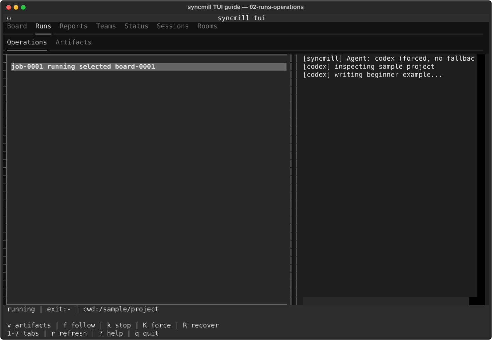

Operations는 TUI가 시작한 detached 작업과 rolling console log를 보여 줍니다.

- 왼쪽: job ID, 상태, 작업 종류와 대상 ID
- 오른쪽: 합쳐진 stdout/stderr의 제한된 rolling log
- 아래: 현재 상태, exit code, 실행 cwd

| 키 | 동작 |
|---|---|
| `f` | 새 로그 끝 자동 따라가기 켜기/끄기 |
| `k` | 프로세스 그룹에 SIGINT로 안전 중단 요청 |
| `K` | 안전 중단 후 10초가 지난 정확한 job을 확인창을 거쳐 SIGKILL |
| `R` | 중단된 standalone apply 복구 |
| `v` | Artifacts 화면으로 전환 |

`K` 확인창에는 job ID, 작업 종류와 대상이 표시됩니다. 체크박스를 선택해도 서버 측
10초 grace 검사를 통과하지 못하면 강제 종료되지 않습니다. `q`로 화면을 닫아도
worker는 계속 실행됩니다. 작업이 없으면 `no TUI jobs`, registry 오류는
`DEGRADED`로 표시됩니다.

## 3. Runs / Artifacts — Summary

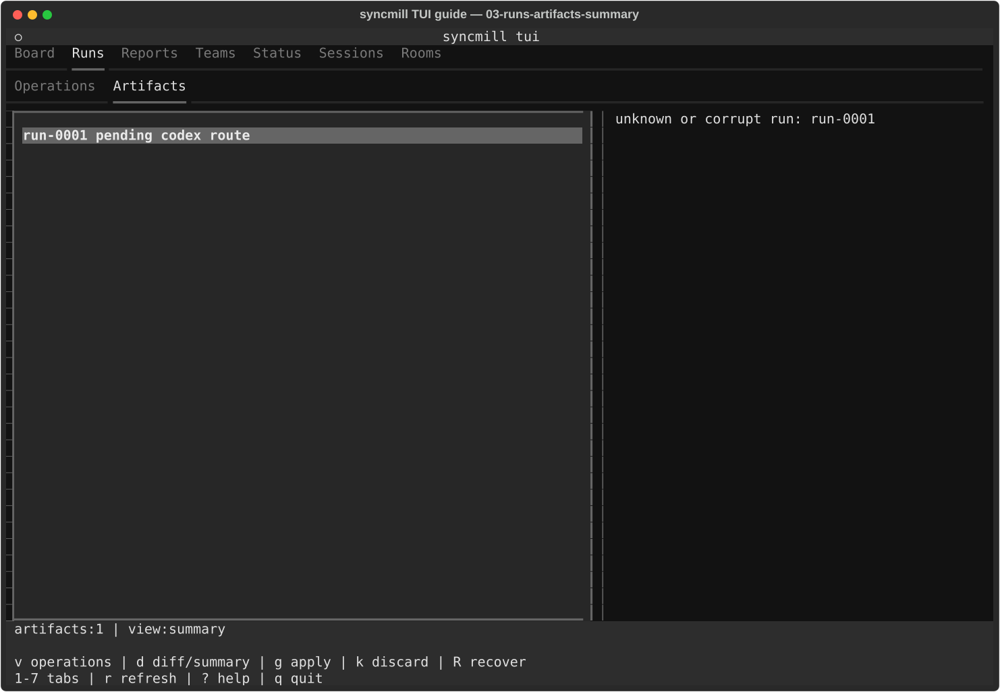

Summary는 agent가 격리 workspace에서 만든 결과를 원본에 적용하기 전에 검토하는
화면입니다.

- 왼쪽: run ID, 상태, agent, 전략 또는 Room 출처
- 오른쪽: 생성 시각, patch 크기와 digest, 변경 파일, 결과·오류·출력
- 아래: artifact 수와 현재 Summary/Diff 보기

`v`는 Operations로, `d`는 Diff로 이동합니다. `g`는 pending standalone run을
확인 후 detached apply하고 Operations로 이동합니다. `k`는 pending run을 폐기합니다.
Session의 `c` checkpoint가 성공하면 이 화면으로 이동해 새 run을 선택합니다.

Room에서 만들어진 run은 여기서 적용할 수 없습니다. `Rooms` 탭에서 후보를 선택하고
적용해야 합니다. `[gate].commands`가 비어 있지 않을 때만 apply 검증 명령이 실행됩니다.

## 4. Runs / Artifacts — Diff

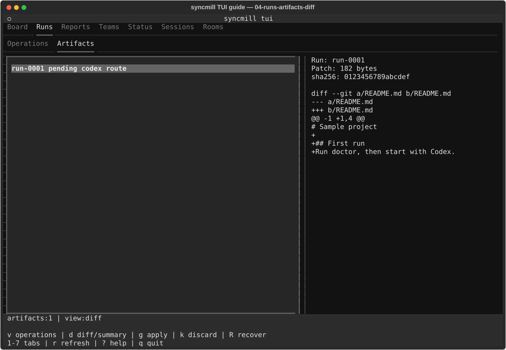

Diff는 digest에 묶여 보존된 patch를 보여 줍니다.

- 텍스트 diff 미리보기는 최대 256 KiB입니다.
- 잘린 diff는 전체 CLI 명령을 안내합니다.
- binary patch는 본문 대신 binary 표시를 보여 줍니다.
- `d`로 Summary와 오가며, `g` 적용·`k` 폐기·`R` 복구 규칙은 같습니다.

`g` 확인창의 run ID, digest와 대상 저장소가 지금 검토한 값인지 확인하세요.
적용 전에는 원본 checkout이 바뀌지 않습니다.

## 5. Reports

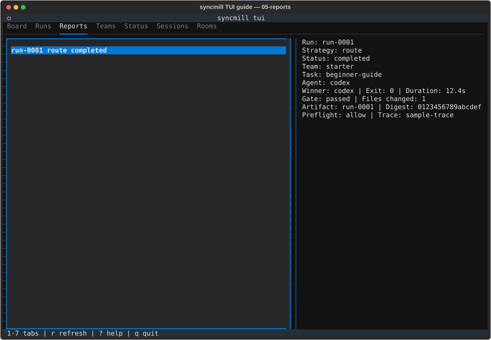

Reports는 완료된 실행 envelope를 읽기 전용으로 봅니다.

- 왼쪽: run ID, 전략, 결과 상태
- 오른쪽: 시작·종료 시각, 팀·작업·agent, winner, exit code, duration, gate,
  변경 파일, artifact/digest, preflight, trace와 degraded 사유
- 단축키: 공통 새로고침과 탐색만 제공

현재 report 기록이 꺼져 있어도 설정된 reports 폴더에 기존 기록이 있으면 표시합니다.
없으면 `(no run reports found)`입니다.

## 6. Teams

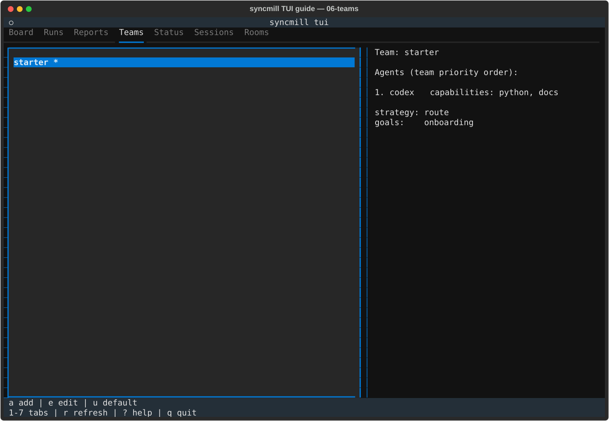

Teams는 반복해서 사용할 agent 조합과 전략을 관리합니다.

- 왼쪽: 팀 이름. 현재 기본 팀에는 `*`
- 오른쪽: agent 우선순위, 설정상 enabled/disabled/unknown, capability, 전략, 목표

| 키 | 동작 |
|---|---|
| `a` | 팀 추가 |
| `e` | 선택 팀 편집 |
| `u` | 기본 팀 지정 또는 해제 |

저장하면 대상 저장소의 `syncmill.toml`이 실제로 변경됩니다. 삭제 기능은 없습니다.
agent의 `enabled`는 설정값일 뿐 설치·로그인 성공을 뜻하지 않습니다.

## 7. Status

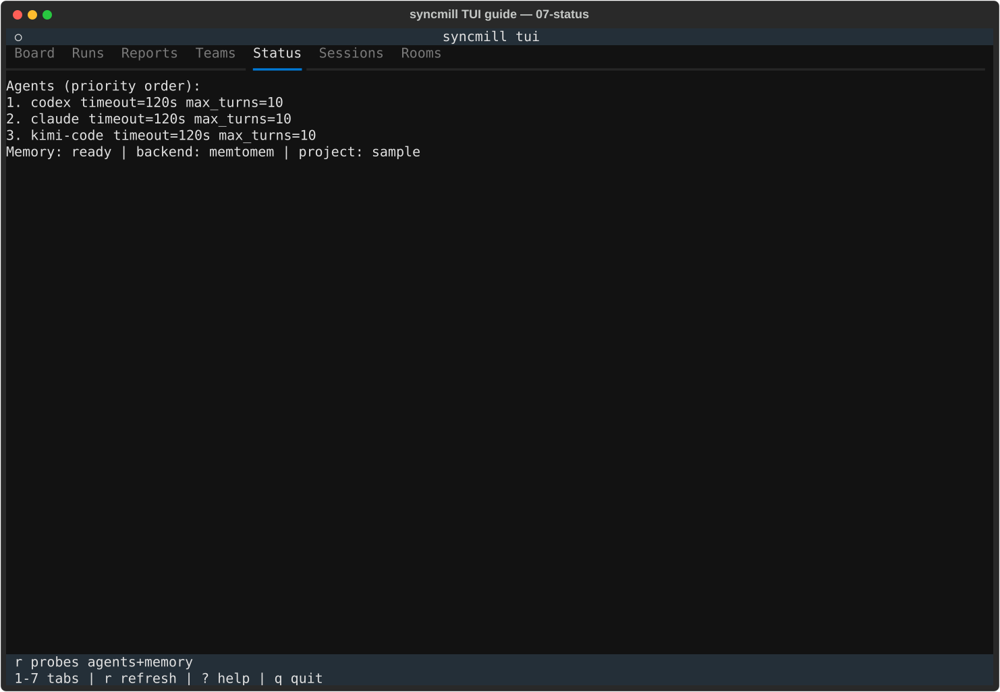

Status는 현재 설정과 memory 상태를 빠르게 확인하는 화면입니다.

- agent 우선순위, 설정상 enabled, timeout, max turns
- memory backend와 마지막 probe 결과
- `r`: 설정을 다시 읽고 memory probe 실행

이 화면은 provider binary나 인증을 검사하지 않습니다. 실제 실행 준비 상태는
`syncmill doctor`로 확인하세요. TUI worker가 실행 중이면 memory probe를 보류할 수
있습니다.

## 8. Sessions

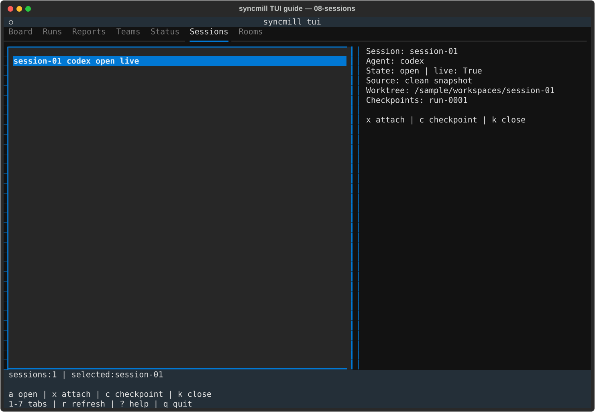

Sessions는 provider의 대화형 CLI를 영속 격리 worktree에서 운용하는 고급 흐름입니다.

- 왼쪽: session ID, agent, 상태, live/stopped, `STALE`
- 오른쪽: source snapshot, worktree, checkpoint 목록

| 키 | 동작 |
|---|---|
| `a` | 격리 native CLI session 생성 |
| `x` | tmux session에 attach |
| `c` | 현재 변경을 검토 가능한 run artifact로 checkpoint |
| `k` | session 닫기 |

`STALE`은 원본 저장소가 session 생성 당시 fingerprint와 달라졌다는 뜻입니다.
checkpoint는 원본을 바꾸지 않고 Runs / Artifacts로 이동합니다. 닫을 때 checkpoint하지
않은 변경이 있으면 삭제 경고를 확인해야 합니다. 저장소가 unavailable이면 `a` 입력창도
열지 않고 복구 안내를 표시합니다.

## 9. Rooms — Diff

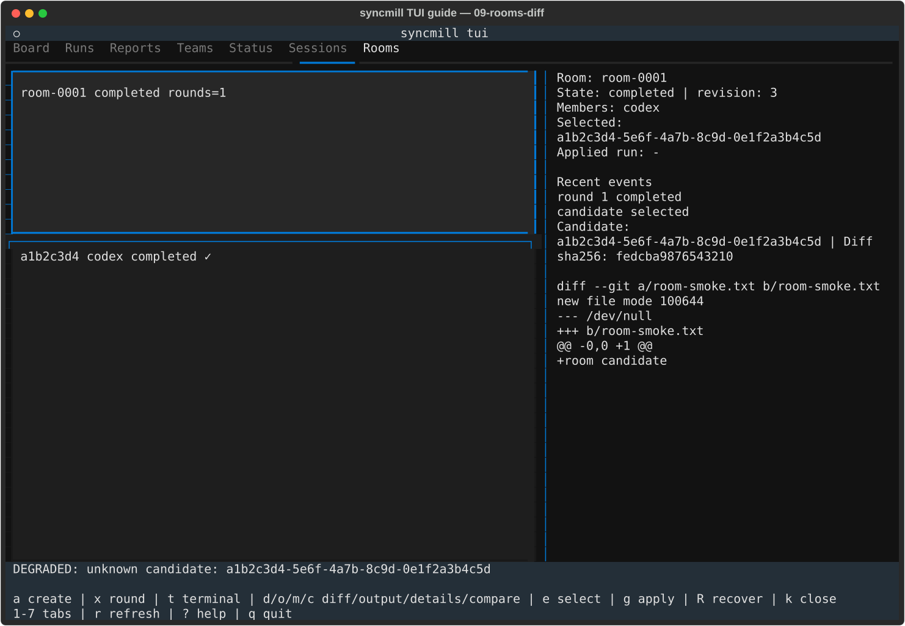

Rooms는 여러 provider 후보를 격리 실행해 비교하고 하나만 선택·적용하는 고급 흐름입니다.

- 왼쪽 위: room ID, 상태, round 수
- 왼쪽 아래: candidate ID, member, 상태, 적용 가능 여부 `✓/×`
- 오른쪽 위: revision, members, 선택 후보, applied run, 최근 이벤트
- 오른쪽 아래: 현재 후보의 Diff

| 키 | 동작 | provider/원본 변경 |
|---|---|---|
| `a` | prompt와 members를 가진 room 생성 | 호출·원본 변경 없음 |
| `x` | 새 round 시작 | member별 provider 호출 |
| `t` | 최신 round의 읽기 전용 tmux viewer | 원본 변경 없음 |
| `d/o/m` | Diff / Output / Details | 읽기 전용 |
| `e` | eligible 후보 선택 | 선택 기록만 변경 |
| `g` | 선택 후보 apply | 확인 후 원본 변경 |
| `R` | 프로젝트 전체 room worker/apply 복구 | 선택 room 전용이 아님 |
| `k` | room 닫기 | workspace/viewer 정리, 후보·receipt 보존 |

완료 후보는 Diff, 실패·timeout 후보는 Output이 기본 화면입니다. `g`는
room/candidate/revision/digest/대상을 고정한 확인창 뒤 Operations로 이동합니다.

## 10. Rooms — Output

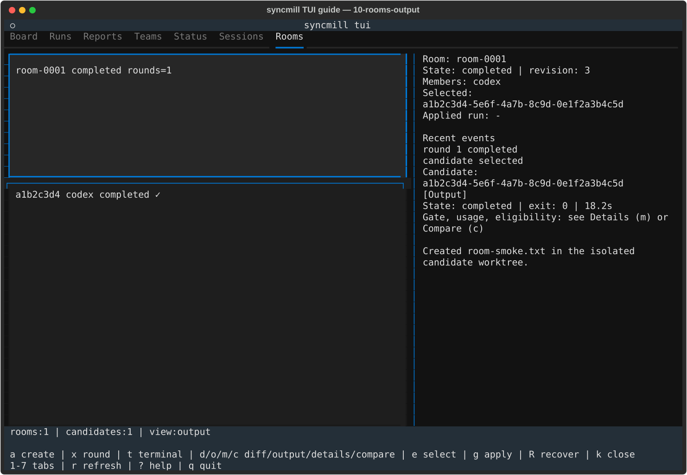

`o`는 후보의 상태, 오류, gate 결과와 제한된 provider 출력을 보여 줍니다. 실패 또는
timeout 후보를 진단할 때 먼저 볼 화면입니다. 출력에는 민감한 agent 내용이 포함될 수
있으므로 TUI job/state 폴더도 비공개 데이터로 취급하세요.

## 11. Rooms — Details

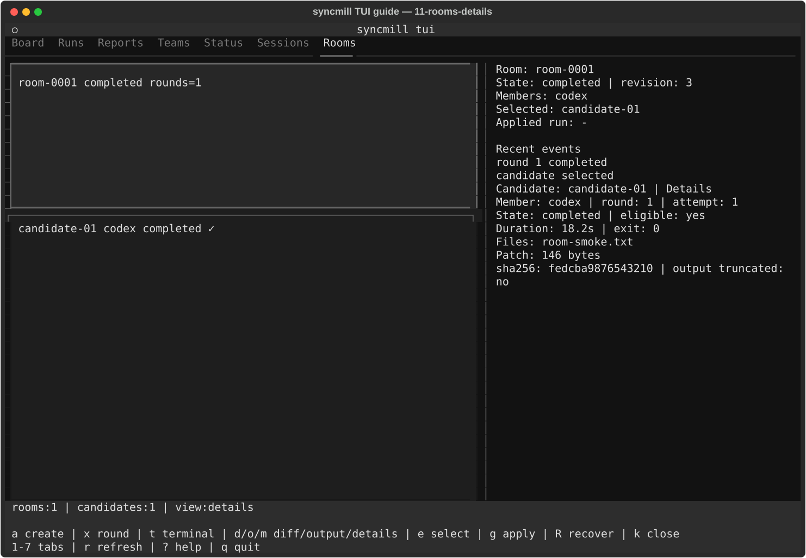

`m`은 round·attempt·member·duration·exit code, gate 명령별 결과, 변경 파일,
patch/output digest와 잘림 여부를 보여 줍니다. Diff와 Output이 비슷해 보이는 후보를
정확한 실행 정보로 비교할 때 사용합니다.

### tmux viewer에서 돌아오기

- TUI 밖에서 tmux viewer가 열렸다면 `Ctrl-b d`로 detach합니다.
- 이미 tmux 안에서 client가 전환됐다면 tmux의 `Prefix + L`로 이전 TUI client로
  돌아갑니다.
- TUI 자체는 tmux를 필요로 하지 않습니다. tmux는 Sessions attach/open과 Rooms
  terminal viewer 경계에서만 사용합니다.

## 화면 자산 검증

이 문서의 SVG는 실제 `SyncmillTuiApp`을 고정된 120×40 화면과 합성 데이터로
렌더링한 결과입니다.

```bash
cd "$SYNCMILL_SRC"
uv run python scripts/render_tui_guide.py
uv run python scripts/render_tui_guide.py --check
```

생성기는 고정 ID·시각·샘플 경로만 사용하며 실제 홈 디렉터리, provider 출력이나
인증 정보를 저장하지 않습니다.
